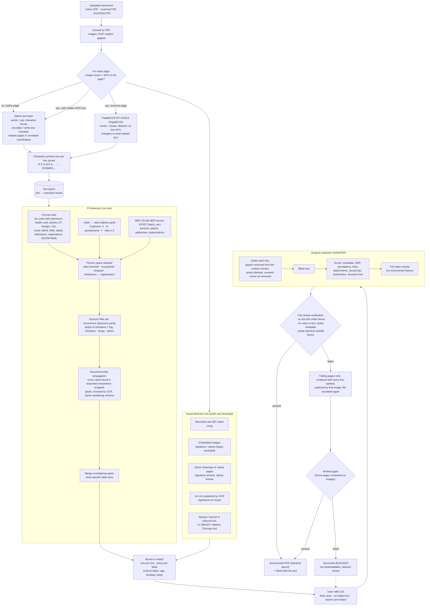

# anonmyzation-pipeline

MIA platform service (AGENAS) for the **surgical anonymization of clinical
documents** (evolution C1). A doctor uploads a referto, a discharge letter or a
prescription (native PDF, scanned PDF, photo); the service finds the personal
data and removes it inside the original file: header, colours, tables and
layout stay identical, only the personal data is replaced by black boxes.
Every output is verified before it can be downloaded (fail-closed). All models
run on-prem.

Generated from `agenas-python-template`: same stack, logging and privacy rules
(see `CLAUDE.md` and `docs/`). The service is stateless: no database.

How the algorithm works, the API, the PII taxonomy, the synthetic dataset and
the evaluation results: **[docs/ANONYMIZATION.md](docs/ANONYMIZATION.md)**.

## How the algorithm works



1. **Text layers.** Every page becomes text in which each character keeps its
   box on the page: from the PDF text layer on native pages (invisible text
   included), from PaddleOCR PP-OCRv5 on scanned pages (side margins read again rotated
   by 90 degrees). Characters printed one per box are joined into one word.
2. **Detection on the text.** Format rules (codice fiscale with checksum,
   tessera sanitaria, Italian and foreign phones, emails, IDs, dates,
   addresses, professional registrations), the value after a form label
   ("Cognome:", "N. accettazione") and the AILAB NER service (`ANONPIP_NER_URL`, fail-closed). An eponym filter decides each occurrence ("segno di Giordano"
   stays, "Sig. Giordano" goes); every value found is searched across the
   whole document, also when wrapped, glued to other words or misread by OCR.
3. **Detection on the pixels and drawings.** Barcodes and QR codes, signatures
   and stamps (embedded images, vector drawings, ink that OCR does not
   explain, framed or coloured stamps).
4. **Boxes.** One box per line of every finding; quasi-identifiers (clinical
   dates, age, facilities) are detected but kept by default. In the web page
   the user can add an area, un-redact a box or search and redact a text.
5. **Surgical redaction.** Inside the original PDF: glyphs under each box are
   removed from the content stream, image pixels blanked, covered vector art
   removed, a black box drawn; then metadata, annotations, links and
   attachments are scrubbed and the file is rewritten from scratch.
6. **Fail-closed verification.** Nothing readable under the boxes, no redacted
   value anywhere in the text, file bytes or metadata, pixels identical outside
   the boxes. A page that fails is replaced by a rendering of itself with the
   boxes painted in (only its pixels survive) and the document is checked
   again; if it still fails it is blocked and cannot be downloaded.

## Quick start

Requirements: `uv`, `just`. A GPU is optional (about 4 s per scanned page on a
laptop RTX 5070, slower on CPU; see "Speed" in [docs/ANONYMIZATION.md](docs/ANONYMIZATION.md)).

```bash
cp .env.example .env
just start          # deps, synthetic dataset, API + web UI on the first free port, browser
```

`just start` downloads the OCR weights on the first run (NER: set `ANONPIP_NER_URL`), generates
`dataset/` if it is missing, and opens `http://127.0.0.1:8000` (or the next
free port) once `/readyz` is ready. OpenAPI on `/docs` (off in prod).

With Docker: `just up` (weights cached in the `models` volume; uncomment the
GPU block in `docker-compose.yml` to use an NVIDIA GPU).

## Commands

| Command | What it does |
|---|---|
| `just start` | Local demo: API + web UI, dataset if missing, browser |
| `just dev` | API on the host with reload |
| `just up` / `just down` / `just logs` | Compose stack |
| `just models` | Download the OCR weights and check the NER service (before an offline start) |
| `just lint` | ruff fix + format + ty: before every commit |
| `just check` | Same checks without fixes (what CI runs) |
| `just test` / `just test-cov` | Unit tests / with coverage (at least 80%) |
| `just dataset [--n 7 --append]` | Synthetic dataset with ground truth -> `dataset/` |
| `just evaluate [--split dev\|test]` | Recall, precision, AP, leaks, verification, time -> `reports/evaluation.md`; `test` is the held-out 30% of the template families, never used for tuning |
| `just eval-ui` | Evaluation viewer on `http://127.0.0.1:8765`: ground truth vs predictions per document, live while evaluating |
| `just audit` | Vulnerabilities in the dependencies |

Developer tools are also available directly: `uv run python -m tools --help`
(`generate`, `anonymize`, `evaluate`, `viewer`, `preview`).

## Layout

```
src/anonmyzation_pipeline/
  main.py                 create_app(), lifespan (pipeline and job manager on app.state)
  config.py               Settings (pydantic-settings, prefix ANONPIP_)
  errors.py               domain errors, Italian messages
  logging_setup.py        setup_logging, log_event, request id
  privacy.py              hashing/masking, user-text redaction, log filter
  api/health.py           /healthz, /readyz (models loaded), /version
  api/anonymization.py    upload, SSE progress, edits, previews, downloads
  api/web.py              demo web page (ANONPIP_UI_ENABLED)
  services/jobs.py        job lifecycle: worker, SSE, edits, expiry, KPI events
  services/anonymization/ engine: layers, ocr, device, pipeline, redact,
                          verify, release (redact + verify + flatten fallback),
                          export_docx
    detect/               rules, labels (+ labels.yaml), ner, eponyms
                          (+ eponyms.yaml), allowlist, ensemble, visual
  web/static/index.html   the page
tools/                    dev only: dataset/ generator, evaluate.py (dev/test split),
                          viewer.py (evaluation UI)
tests/unit/               no network, no model weights (fake OCR and NER)
docs/                     ANONYMIZATION.md, logging and privacy, deploy handover
```

## Results

`just evaluate` on the whole evaluation set (`dataset/`: 200 documents, 326
pages, each as native PDF, scan and scan with a hidden OCR layer: 600 PDFs;
AILAB NER service, PaddleOCR PP-OCRv5; 20/10/2026). In brackets the earlier
in-pod GLiNER + GLiNER2 (commit `92ae6e5`), measured the same day:

| | native | scan | scan + OCR layer |
|---|---|---|---|
| **Recall** (box, required PII) | 0.938 (0.948) | 0.909 (0.915) | 0.939 (0.944) |
| **Precision** (box) | 0.959 (0.970) | 0.928 (0.938) | 0.884 (0.904) |
| **F1** (box) | 0.948 (0.959) | 0.918 (0.926) | 0.911 (0.924) |
| Precision / recall / F1 (word) | 0.946 / 0.950 / 0.948 | 0.745 / 0.926 / 0.826 | 0.706 / 0.954 / 0.811 |
| **Accuracy** (word) | 0.987 | 0.950 | 0.943 |
| **AP@0.5** (PII, label-agnostic) | 0.658 | 0.576 | 0.502 |
| **mAP@0.5** (mean over PII types) | 0.670 | 0.564 | 0.559 |
| Hidden PII leaked (white text, metadata, OCR layers) | 0/324 | n/a | 1/324 |
| Eponyms wrongly redacted | 54/415 | 72/415 | 100/415 |
| Documents passing verification | 200/200 | 200/200 | 200/200 |
| Seconds per page (laptop RTX 5090, 24 GB) | 0.7 | 3.5 | 4.0 |

With the AILAB service recall is 0.5 to 1 point lower and precision 1 to 2
points lower than with GLiNER: names it replaces as eponyms, foreign names and
fragments taken for places (details in docs/ANONYMIZATION.md, "NER choice").
Run `just evaluate` again to refresh the table; `--split test` scores only the
77 held-out documents.

- **Box level** (scikit-learn): every required ground-truth box is found when
  redaction covers at least 75% of it; every redaction box touching no ground
  truth is a false positive; boxes on quasi-identifiers only are ignored.
- **Word level** (scikit-learn): every word of the page, PII or not, redacted
  or not; the only level with true negatives, hence the only meaningful accuracy.
- **AP / mAP@0.5** (torchmetrics, COCO protocol): detections ranked by
  confidence, IoU 0.5, quasi-identifiers and invisible text as ignore regions,
  duplicates collapsed by NMS (torchvision). AP is lower than recall on scans
  because it also scores localisation: the misaligned boxes of a scanner's
  hidden OCR layer count as duplicates, signatures are covered by an ink box
  smaller than the ground-truth image box, and address, CAP and city are
  annotated separately but detected as one box.

Recall is the safety metric (a missed value is a leak). Definitions, per-type
results and the analysis are in [docs/ANONYMIZATION.md](docs/ANONYMIZATION.md);
every miss is listed in `reports/evaluation.md`.

## Notes

- The web page is for local testing and demos (Italian UI, it follows the MIA
  mockups); in the platform the doctor-facing frontend is `fe`.
- PyMuPDF is AGPL: production use needs an Artifex commercial licence or AGPL compliance.
- Deploy: `docs/DEPLOY_HANDOVER.md` lists image, variables, resources and the
  model weights the platform team has to provide (the cluster has no internet access).
