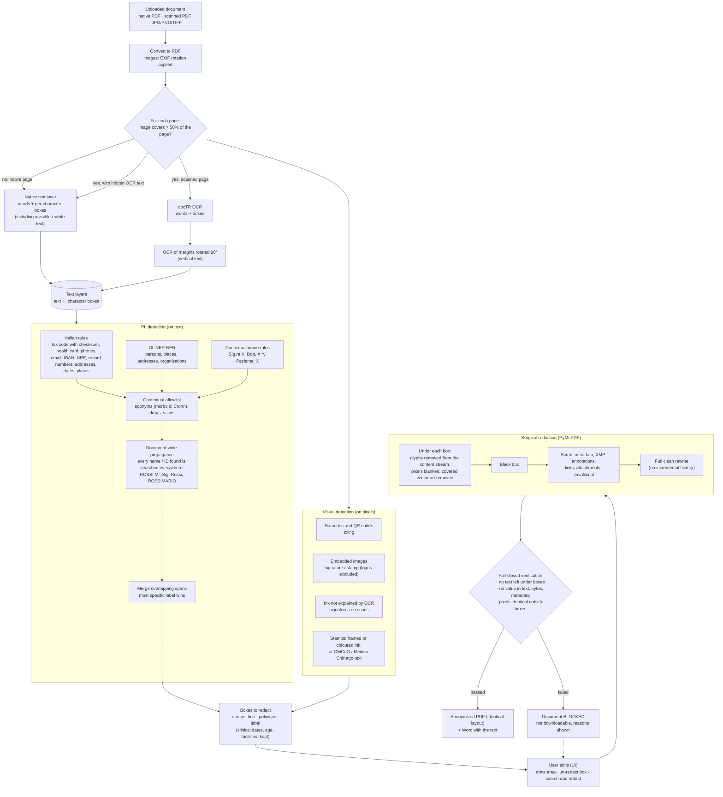

# anonmyzation-pipeline

MIA platform service (AGENAS) for the **surgical anonymization of clinical
documents** (evolution C1). A doctor uploads a referto, a discharge letter or a
prescription (native PDF, scanned PDF, photo); the service finds the personal
data and removes it inside the original file: header, colours, tables and
layout stay identical, only the personal data is replaced by black boxes.
Every output is verified before it can be downloaded (fail-closed). All models
run on-prem.

Generated from `agenas-python-template`: same stack, logging and privacy rules
(see `CLAUDE.md` and `docs/`). The service is stateless: no database.

How the algorithm works, the API, the PII taxonomy, the synthetic dataset and
the evaluation results: **[docs/ANONYMIZATION.md](docs/ANONYMIZATION.md)**.

## How the algorithm works



1. **Text layers.** Every page becomes text in which each character keeps its
   box on the page: from the PDF text layer on native pages (invisible text
   included), from docTR OCR on scanned pages (side margins read again rotated
   by 90 degrees for vertical text).
2. **Detection on the text.** Italian rules (codice fiscale with checksum,
   tessera sanitaria, phones, emails, IDs, addresses, dates, places), GLiNER
   NER and contextual name rules; an allowlist keeps eponyms, drugs and saints
   ("morbo di Crohn" stays, "Sig. Corti" goes); every name and identifier found
   is searched across the whole document in all its forms.
3. **Detection on the pixels.** Barcodes and QR codes, signatures and stamps
   (embedded images, ink that OCR does not explain, framed or coloured stamps).
4. **Boxes.** One box per line of every finding; quasi-identifiers (clinical
   dates, age, facilities) are detected but kept by default. In the web page
   the user can add an area, un-redact a box or search and redact a text.
5. **Surgical redaction.** Inside the original PDF: glyphs under each box are
   removed from the content stream, image pixels blanked, covered vector art
   removed, a black box drawn; then metadata, annotations, links and
   attachments are scrubbed and the file is rewritten from scratch.
6. **Fail-closed verification.** Nothing readable under the boxes, no redacted
   value anywhere in the text, file bytes or metadata, pixels identical outside
   the boxes. Otherwise the document is blocked and cannot be downloaded.

## Quick start

Requirements: `uv`, `just`. A GPU is optional (about 2 s per scanned page on a
laptop RTX 5070, slower on CPU).

```bash
cp .env.example .env
just start          # deps, synthetic dataset, API + web UI on the first free port, browser
```

`just start` downloads the OCR and NER weights on the first run, generates
`dataset/` if it is missing, and opens `http://127.0.0.1:8000` (or the next
free port) once `/readyz` is ready. OpenAPI on `/docs` (off in prod).

With Docker: `just up` (weights cached in the `models` volume; uncomment the
GPU block in `docker-compose.yml` to use an NVIDIA GPU).

## Commands

| Command | What it does |
|---|---|
| `just start` | Local demo: API + web UI, dataset if missing, browser |
| `just dev` | API on the host with reload |
| `just up` / `just down` / `just logs` | Compose stack |
| `just models` | Download the OCR and NER weights (before an offline start) |
| `just lint` | ruff fix + format + ty: before every commit |
| `just check` | Same checks without fixes (what CI runs) |
| `just test` / `just test-cov` | Unit tests / with coverage (at least 80%) |
| `just dataset [--n 7 --append]` | Synthetic dataset with ground truth -> `dataset/` |
| `just evaluate` | Recall, leaks, over-redaction, verification, time -> `reports/evaluation.md` |
| `just bench-ocr --engines doctr,lighton` | OCR comparison on the scanned dataset |
| `just audit` | Vulnerabilities in the dependencies |

Developer tools are also available directly: `uv run python -m tools --help`
(`generate`, `anonymize`, `evaluate`, `bench-ocr`, `preview`).

## Layout

```
src/anonmyzation_pipeline/
  main.py                 create_app(), lifespan (pipeline and job manager on app.state)
  config.py               Settings (pydantic-settings, prefix ANONPIP_)
  errors.py               domain errors, Italian messages
  logging_setup.py        setup_logging, log_event, request id
  privacy.py              hashing/masking, user-text redaction, log filter
  api/health.py           /healthz, /readyz (models loaded), /version
  api/anonymization.py    upload, SSE progress, edits, previews, downloads
  api/web.py              demo web page (ANONPIP_UI_ENABLED)
  services/jobs.py        job lifecycle: worker, SSE, edits, expiry, KPI events
  services/anonymization/ engine: layers, ocr, detect/ (rules, ner, allowlist,
                          ensemble, visual), pipeline, redact, verify, export_docx
  web/static/index.html   the page
tools/                    dev only: dataset/ generator, evaluate.py, bench_ocr.py
tests/unit/               no network, no model weights (fake OCR and NER)
docs/                     ANONYMIZATION.md, logging and privacy, deploy handover
```

## Results

`just evaluate` on the synthetic dataset (`just dataset`: 21 documents of 7
types, each as native PDF, scan and scan with a hidden OCR layer, 27 pages per
variant; laptop RTX 5070):

| | native | scan | scan + OCR layer |
|---|---|---|---|
| **Recall** (box, required PII) | 0.998 | 0.937 | 0.986 |
| **Precision** (box) | 0.949 | 0.961 | 0.903 |
| **F1** (box) | 0.973 | 0.949 | 0.943 |
| Precision / recall / F1 (word) | 0.925 / 0.990 / 0.956 | 0.888 / 0.920 / 0.903 | 0.860 / 0.983 / 0.917 |
| **Accuracy** (word) | 0.987 | 0.973 | 0.976 |
| **AP@0.5** (PII, label-agnostic) | 0.951 | 0.756 | 0.522 |
| **mAP@0.5** (mean over PII types) | 0.954 | 0.776 | 0.781 |
| Hidden PII leaked (white text, metadata, deleted notes) | 0/98 | 0/98 | 0/98 |
| Eponyms wrongly redacted | 0/36 | 0/36 | 0/36 |
| Documents passing verification | 21/21 | 21/21 | 21/21 |
| Seconds per page | 0.35 | 1.8 | 1.9 |

- **Box level** (scikit-learn): every required ground-truth box is found when
  redaction covers at least 60% of it; every redaction box touching no ground
  truth is a false positive; boxes on quasi-identifiers only are ignored.
- **Word level** (scikit-learn): every word of the page, PII or not, redacted
  or not; the only level with true negatives, hence the only meaningful accuracy.
- **AP / mAP@0.5** (torchmetrics, COCO protocol): detections ranked by
  confidence, IoU 0.5, quasi-identifiers and invisible text as ignore regions,
  duplicates collapsed by NMS (torchvision). AP is lower than recall on scans
  because it also scores localisation: the misaligned boxes of a scanner's
  hidden OCR layer count as duplicates, signatures are covered by an ink box
  smaller than the ground-truth image box, and address, CAP and city are
  annotated separately but detected as one box.

Recall is the safety metric (a missed value is a leak). Definitions, per-type
results and the analysis are in [docs/ANONYMIZATION.md](docs/ANONYMIZATION.md);
every miss is listed in `reports/evaluation.md`.

## Notes

- The web page is for local testing and demos (Italian UI, it follows the MIA
  mockups); in the platform the doctor-facing frontend is `fe`.
- PyMuPDF is AGPL: production use needs an Artifex commercial licence or AGPL compliance.
- Deploy: `docs/DEPLOY_HANDOVER.md` lists image, variables, resources and the
  model weights the platform team has to provide (the cluster has no internet access).
