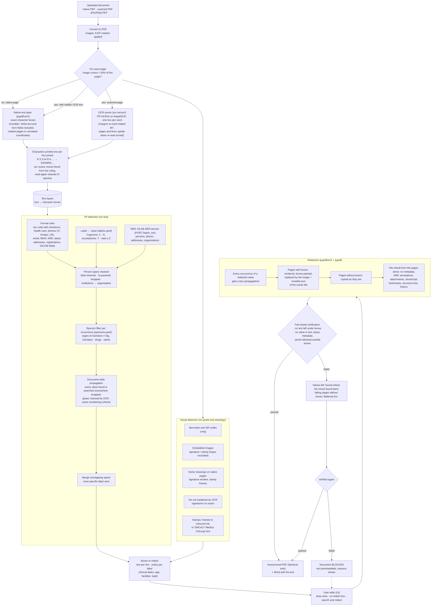
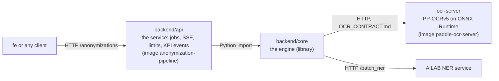

# anonymization-pipeline

MIA platform service (AGENAS) for the **anonymization of clinical documents**
(evolution C1). A doctor uploads a referto, a discharge letter or a
prescription (native PDF, scanned PDF, photo); the service finds the personal
data and removes it: pages with personal data are replaced by an image of
themselves with black boxes painted in (layout, colours and tables look the
same, an invisible text layer keeps them searchable), the other pages stay as
they are. Every output is verified before it can be downloaded (fail-closed).
All models run on-prem, on open-source components with permissive licences
(pypdfium2, pypdf, LiteParse, RapidOCR with PP-OCRv5 models). OCR runs in a second
service, `ocr-server/`; NER runs in the AILAB NER service.

Generated from `agenas-python-template`: same stack, logging and privacy rules
(see `CLAUDE.md` and `docs/`). The service is stateless: no database.

Two modes, chosen at upload (`POST /anonymizations?mode=`): `accurate` (default)
releases the redacted PDF, reviewable side by side and editable by hand; `fast`
releases only the anonymized text as Markdown, with page delimiters, tables
as Markdown tables and `[IMMAGINE]` placeholders.

How the algorithm works, the API, the PII taxonomy and the evaluation results:
**[docs/ANONYMIZATION.md](docs/ANONYMIZATION.md)**.

The repository holds the engine, the API, the OCR server and the evaluation
CLI (`evaluation/`: scoring against the dataset in `dataset/`).

## How the algorithm works



1. **Text layers.** Every page becomes text in which each character keeps its
   box on the page: from the PDF text layer read by pypdfium2 on native pages
   (invisible text and form fields included), from the OCR server (PP-OCRv5) on
   scanned pages (side margins read again rotated by 90 degrees; pages and lines
   upside down read again turned by 180 degrees). Lines are rebuilt from
   geometry; characters printed one per box are joined into one word. On scans
   the boxes are found from the ruling of the form and read again cleaned of
   specks (recognition only, on the OCR server).
2. **Detection on the text.** Format rules (codice fiscale with checksum,
   tessera sanitaria, Italian and foreign phones, emails, IDs, dates,
   addresses, professional registrations), the value after a form label
   ("Cognome:", "N. accettazione") and the AILAB NER service (`ANONPIP_NER_URL`, fail-closed). An eponym filter decides each occurrence ("segno di Giordano"
   stays, "Sig. Giordano" goes); every value found is searched across the
   whole document, also when wrapped, glued to other words or misread by OCR.
3. **Detection on the pixels and drawings.** Barcodes and QR codes, signatures
   and stamps (embedded images, vector drawings, ink that OCR does not
   explain, framed or coloured stamps).
4. **Boxes.** One box per line of every finding; quasi-identifiers (clinical
   dates, age, facilities) are detected but kept by default. Through the API
   (`POST /{id}/edits`) the user can add an area, un-redact a box or search and redact a text.
5. **Redaction.** Every occurrence of a redacted value gets a box. Each page
   with a box is replaced by a rendering of itself with the boxes painted in
   (only its pixels survive) plus an invisible text layer of the words left;
   the other pages are copied; pypdf rebuilds the file from the pages alone
   (no metadata, annotations, attachments, bookmarks, history).
6. **Fail-closed verification.** Nothing readable under the boxes, no redacted
   value anywhere in the text, file objects or metadata, pixels identical
   outside the boxes. A value still found is boxed where the check found it and
   the document is checked again; if it still fails it is blocked and cannot be
   downloaded.

## Quick start

Requirements: `uv`, `just`. A GPU is optional (about 2.5 s per scanned page on a
laptop RTX 5070, slower on CPU; see "Speed" in [docs/ANONYMIZATION.md](docs/ANONYMIZATION.md)).

```bash
cp .env.example .env
just start          # deps, OCR server, API on the first free port, OpenAPI page in the browser
```

`just start` starts the OCR server (`ocr-server/`, port 8829) unless one is
already running, downloads the OCR weights on the first run (NER: set
`ANONPIP_NER_URL` to the AILAB NER service), starts the API on
`http://127.0.0.1:8000` (or the next free port) and opens its OpenAPI page
(`/docs`, off in prod) once `/readyz` is ready.
`just dev` needs the OCR server too: `just ocr-server`.

With Docker: `just up` starts the API and the OCR server (weights cached in the `models`
volume; uncomment the GPU blocks in `docker-compose.yml` and set
`OCR_EXTRA=gpu` to use an NVIDIA GPU).

## Commands

| Command | What it does |
|---|---|
| `just start` | Local run: OCR server and API, OpenAPI page in the browser |
| `just dev` | API on the host with reload |
| `just up` / `just down` / `just logs` | Compose stack (API, OCR server) |
| `just models` | Check the OCR server and the NER service (both must answer) |
| `just ocr-server [cpu]` / `just ocr-server-test` | OCR server on the host, port 8829 / its unit tests |
| `just lint` | ruff fix + format + ty: before every commit |
| `just check` | Same checks without fixes (what CI runs) |
| `just test` / `just test-cov` | Unit tests of every package / with coverage (at least 80% per package) |
| `just test-core` / `just test-api` / `just test-eval` | One suite only (arguments go to pytest) |
| `just evaluate [--variants scan --split test --limit 20]` | Score the engine against `dataset/` -> `reports/evaluation.md` (needs the OCR server and NER) |
| `just eval-compare reports_a reports_b` | Two evaluations side by side -> `reports/comparison.md` |
| `just audit` | Vulnerabilities in the dependencies |

## Modules

One folder per pod. `backend/` is the service pod: the API and the engine, two
packages built into one image. `ocr-server/` is the OCR pod, called by the
backend over HTTP. Each package has its own dependencies, tests and lint, so it
can be extracted on its own:



| Package | Depends on | Never imports | Tests |
|---|---|---|---|
| `backend/core` | OCR server and NER over HTTP | the service, any web framework | `just test-core` |
| `backend/api` | the engine | - | `just test-api` |
| `ocr-server` | - (own lock, outside the workspace) | - | `just ocr-server-test` |
| `evaluation` | the engine (dev only, never in an image) | the service | `just test-eval` |

The "never imports" column is enforced by ruff (`banned-api` in each
`pyproject.toml`). To extract the engine, copy its folder: see
[backend/core/README.md](backend/core/README.md).

## Layout

The backend packages and the evaluation form a uv workspace: one lock, each package with its own
dependencies, tests and lint config. The root is not a package: its dev group is
the developer environment (every member). The OCR server has its own lock.

```
backend/                pod 1, image anonymization-pipeline
  Dockerfile            builds api + core (context: the repository root)
  core/                 the engine, a library: no web framework, never imports the
                        service (banned in its pyproject); own tests, coverage and
                        lint config, so it can be extracted as is
    src/anonymization_core/
      config.py             PipelineConfig (plain values, no environment lookup)
      factory.py            build_pipeline, load_models
      errors.py             engine errors (the service maps them to HTTP)
      convert.py            upload (PDF or image) -> PDF
      document.py           releases (PDF + Word, Markdown), manual edits, page images
      reader.py, layers.py, geometry.py, pdf_pages.py, pdf_text.py, cells.py
                            text layers: pypdfium2 text, LiteParse + OCR server
      pipeline.py           analysis: text layers -> findings -> boxes
      release.py, verify.py flatten pages with boxes + pypdf rewrite, checks
      export_docx.py, export_markdown.py, taxonomy.py
      detect/               rules, labels (+ labels.yaml), ner, eponyms
                            (+ eponyms.yaml), allowlist, ensemble, visual
      testing.py            synthetic PDFs and fake engines (extra `testing`)
    tests/                  engine tests: `just test-core`
  api/                  the service: scripts/entrypoint.sh, own tests (`just test-api`)
    src/anonymization_pipeline/
      main.py               create_app(), lifespan (pipeline and job manager on app.state)
      config.py             Settings (pydantic-settings, prefix ANONPIP_), pipeline_config()
      errors.py             service errors, Italian messages, engine error mapping
      logging_setup.py      setup_logging, log_event, request id
      privacy.py            hashing/masking, user-text redaction, log filter
      api/health.py         /healthz, /readyz (models loaded), /version
      api/anonymization.py  upload, SSE progress, edits, previews, downloads
      services/jobs.py      job lifecycle around the engine: queue, SSE, expiry, limits, KPI events
ocr-server/             pod 2, image paddle-ocr-server: PP-OCRv5 (RapidOCR) behind the
                        LiteParse OCR API; own pyproject, lock and Dockerfile (ONNX
                        Runtime, CPU or GPU), outside the workspace: `just ocr-server-test`
docs/                   ANONYMIZATION.md, PDF_BACKEND_GAPS.md, logging and privacy,
                        deploy handover
evaluation/             evaluation CLI (dev only, never in an image): `just evaluate`,
                        `just eval-compare`; reads `dataset/`, writes `reports/`
  src/anonymization_eval/
    evaluate.py           scoring per variant, Markdown report, comparison of two runs
    metrics.py            box and word level scores (scikit-learn), AP / mAP (torchmetrics)
    pdf.py                the judge: words and file content of the output PDFs
scripts/                start.sh: OCR server and API on the host (`just start`)
```

## Results

Measured with `just evaluate` on the whole evaluation set: 200 documents, 326
pages, each as native PDF, scan and scan with a hidden OCR layer (600 PDFs;
22/10/2026), with the AILAB NER service and the OCR server on a laptop RTX 5070
(8 GB):

| | native | scan | scan + OCR layer |
|---|---|---|---|
| **Recall** (box, required PII) | 0.940 | 0.918 | 0.933 |
| **Precision** (box) | 0.954 | 0.926 | 0.872 |
| **F1** (box) | 0.947 | 0.922 | 0.902 |
| Precision / recall / F1 (word) | 0.941 / 0.952 / 0.946 | 0.785 / 0.941 / 0.856 | 0.737 / 0.954 / 0.832 |
| **Accuracy** (word) | 0.986 | 0.960 | 0.951 |
| **AP@0.5** (PII, label-agnostic) | 0.663 | 0.595 | 0.519 |
| **mAP@0.5** (mean over PII types) | 0.674 | 0.582 | 0.568 |
| Hidden PII leaked (white text, metadata, OCR layers) | 1/324 | n/a | 0/324 |
| Eponyms wrongly redacted | 65/415 | 77/415 | 108/415 |
| Documents passing verification | 200/200 | 200/200 | 200/200 |
| Seconds per page | 0.75 | 2.54 | 2.67 |

By type: codice fiscale 99% / 94% / 96% (native / scan / scan + OCR layer),
tessera sanitaria 100%, persons 96% to 97%, barcodes, QR codes, URLs and IBAN
97% to 100%. The weakest are internal record numbers (MEDICAL_RECORD, 74% to
79%: numbers with no label, or a label the vocabulary lacks), identity documents
on plain scans (70%) and handwriting, which is not detected (0 of 21: the manual
edits cover it). Per-type recall and AP and every miss are in the report that
`just evaluate` writes (`reports/evaluation.md`); details in
[docs/ANONYMIZATION.md](docs/ANONYMIZATION.md).

- **Box level** (scikit-learn): every required ground-truth box is found when
  redaction covers at least 75% of it; every redaction box touching no ground
  truth is a false positive; boxes on quasi-identifiers only are ignored.
- **Word level** (scikit-learn): every word of the page, PII or not, redacted
  or not; the only level with true negatives, hence the only meaningful accuracy.
- **AP / mAP@0.5** (torchmetrics, COCO protocol): detections ranked by
  confidence, IoU 0.5, quasi-identifiers and invisible text as ignore regions,
  duplicates collapsed by NMS (torchvision). AP is lower than recall on scans
  because it also scores localisation: the misaligned boxes of a scanner's
  hidden OCR layer count as duplicates, signatures are covered by an ink box
  smaller than the ground-truth image box, and address, CAP and city are
  annotated separately but detected as one box.

Recall is the safety metric (a missed value is a leak). Definitions, per-type
results and the analysis are in [docs/ANONYMIZATION.md](docs/ANONYMIZATION.md).

## Notes

- The API serves no page: in the platform the doctor-facing frontend is `fe`.
- Licences: every component is open source; the licence audit and the few
  non-permissive transitive packages are in
  [docs/PDF_BACKEND_GAPS.md](docs/PDF_BACKEND_GAPS.md).
- Technical document (Italian, BV TECH format, 10 pages):
  `docs/anonymization-pipeline.pdf`.
- Deploy: `docs/DEPLOY_HANDOVER.md` lists image, variables, resources and the
  model weights the platform team has to provide (the cluster has no internet access).
