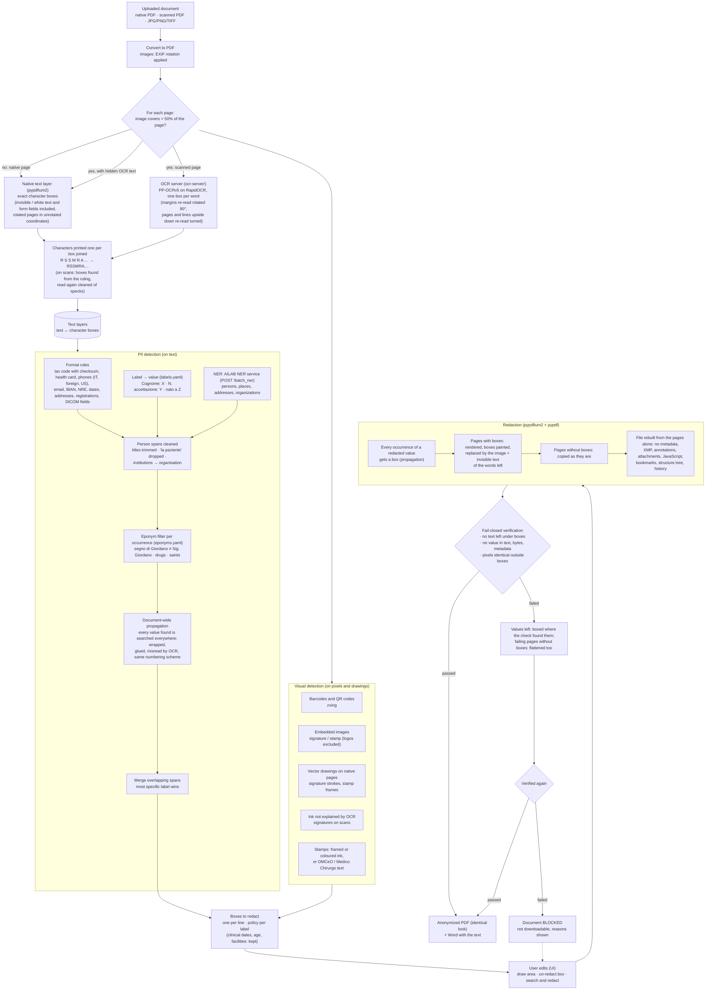
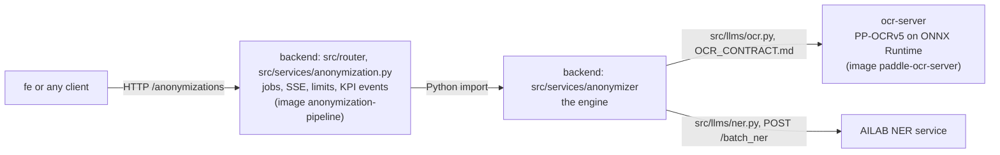

# anonymization-pipeline

MIA platform service (AGENAS) for the **anonymization of clinical documents**
(evolution C1). A doctor uploads a referto, a discharge letter or a
prescription (native PDF, scanned PDF, photo); the service finds the personal
data and removes it: pages with personal data are replaced by an image of
themselves with black boxes painted in (layout, colours and tables look the
same, an invisible text layer keeps them searchable), the other pages stay as
they are. Every output is verified before it can be downloaded (fail-closed).
All models run on-prem, on open-source components with permissive licences
(pypdfium2, pypdf, LiteParse, RapidOCR with PP-OCRv5 models). OCR runs in a second
service, `ocr-server/`; NER runs in the AILAB NER service.

Generated from `agenas-python-template`: same stack, logging and privacy rules
(see the `AGENTS.md` of each service and `docs/`). The service is stateless: no database.

Two modes, chosen at upload (`POST /anonymizations?mode=`): `accurate` (default)
releases the redacted PDF, reviewable side by side and editable by hand; `fast`
releases only the anonymized text as Markdown, with page delimiters, tables
as Markdown tables and `[IMMAGINE]` placeholders.

How the algorithm works, the API, the PII taxonomy and the evaluation results:
**[docs/ANONYMIZATION.md](docs/ANONYMIZATION.md)**.

The repository holds two services, each with the folder structure of
ai-platform-v2: `backend/` (the API and the engine, with the evaluation CLI in
`backend/evals/`) and `ocr-server/`.

## How the algorithm works



1. **Text layers.** Every page becomes text in which each character keeps its
   box on the page: from the PDF text layer read by pypdfium2 on native pages
   (invisible text and form fields included), from the OCR server (PP-OCRv5) on
   scanned pages (side margins read again rotated by 90 degrees; pages and lines
   upside down read again turned by 180 degrees). Lines are rebuilt from
   geometry; characters printed one per box are joined into one word. On scans
   the boxes are found from the ruling of the form and read again cleaned of
   specks (recognition only, on the OCR server).
2. **Detection on the text.** Format rules (codice fiscale with checksum,
   tessera sanitaria, Italian and foreign phones, emails, IDs, dates,
   addresses, professional registrations), the value after a form label
   ("Cognome:", "N. accettazione") and the AILAB NER service (`ANONPIP_NER_URL`, fail-closed). An eponym filter decides each occurrence ("segno di Giordano"
   stays, "Sig. Giordano" goes); every value found is searched across the
   whole document, also when wrapped, glued to other words or misread by OCR.
3. **Detection on the pixels and drawings.** Barcodes and QR codes, signatures
   and stamps (embedded images, vector drawings, ink that OCR does not
   explain, framed or coloured stamps).
4. **Boxes.** One box per line of every finding; quasi-identifiers (clinical
   dates, age, facilities) are detected but kept by default. Through the API
   (`POST /{id}/edits`) the user can add an area, un-redact a box or search and redact a text.
5. **Redaction.** Every occurrence of a redacted value gets a box. Each page
   with a box is replaced by a rendering of itself with the boxes painted in
   (only its pixels survive) plus an invisible text layer of the words left;
   the other pages are copied; pypdf rebuilds the file from the pages alone
   (no metadata, annotations, attachments, bookmarks, history).
6. **Fail-closed verification.** Nothing readable under the boxes, no redacted
   value anywhere in the text, file objects or metadata, pixels identical
   outside the boxes. A value still found is boxed where the check found it and
   the document is checked again; if it still fails it is blocked and cannot be
   downloaded.

## Quick start

Requirements: `uv`, `just`. A GPU is optional (about 2.5 s per scanned page on a
laptop RTX 5070, slower on CPU; see "Speed" in [docs/ANONYMIZATION.md](docs/ANONYMIZATION.md)).

```bash
cp backend/.env.example backend/.env         # the service's settings (ANONPIP_*)
cp ocr-server/.env.example ocr-server/.env   # the OCR server's settings (OCRSRV_*)
cp infra/.env.example infra/.env             # compose variables (OCR_EXTRA, ports)
just start          # deps, OCR server, API on the first free port, OpenAPI page in the browser
```

`just start` starts the OCR server (`ocr-server/`, port 8829) unless one is
already running, downloads the OCR weights on the first run (NER: set
`ANONPIP_NER_URL` to the AILAB NER service), starts the API on
`http://127.0.0.1:8000` (or the next free port) and opens its OpenAPI page
(`/docs`, off in prod) once `/readyz` is ready.
`just backend::dev` needs the OCR server too: `just ocr::serve`.

With Docker: `just up` starts the API and the OCR server from
`infra/docker-compose.yml` (weights cached in the `models` volume; uncomment
the GPU block in `infra/docker-compose.yml` and set
`OCR_EXTRA=gpu` to use an NVIDIA GPU).

## Commands

From the repository root; each service also has its own `justfile`
(`cd backend && just test` is the same as `just backend::test`).

| Command | What it does |
|---|---|
| `just start` | Local run: OCR server and API, OpenAPI page in the browser |
| `just up` / `just down` / `just logs` | Compose stack (`infra/docker-compose.yml`: API, OCR server) |
| `just ocr::serve [cpu]` / `just ocr::test [cpu]` | OCR server on the host, port 8829 / its unit tests (`gpu` by default) |
| `just ocr::lint` / `just ocr::check` | ruff + ty of the OCR server |
| `just backend::dev` | API on the host with reload |
| `just backend::models` | Check the OCR server and the NER service (both must answer) |
| `just backend::lint` / `just backend::check` | ruff fix + format + ty (before every commit) / the same without fixes (CI) |
| `just backend::test` / `just backend::test-cov` | Unit tests / with coverage (at least 80%) |
| `just backend::evals-test` | Tests of the evaluation (installs the `evals` group: torch, scikit-learn) |
| `just backend::evaluate [--variants scan --split test --limit 20]` | Score the engine against `dataset/` -> `reports/evaluation.md` (needs the OCR server and NER) |
| `just backend::eval-compare ../reports_a ../reports_b` | Two evaluations side by side -> `reports/comparison.md` |
| `just backend::audit` | Vulnerabilities in the dependencies |

The evaluation needs the gold set in `dataset/` (not in git, not in the
repository: copy it there; only its 42 `NNN_` documents can be regenerated) and
writes to `reports/`, also outside git.

## Services

One folder per pod, each a uv project of its own (dependencies, lock, tests,
Dockerfile, justfile, AGENTS.md), with the structure of ai-platform-v2: code in
a flat `src/` package imported as `src.*`, served as `src.main:app`.



The engine is a self-contained sub-package of the backend: `ruff.toml` in its
folder bans the router, the session service, the app, `Settings` and any web
framework. The evaluation (`backend/evals/`) uses the engine and never the
service. See [backend/src/services/anonymizer/README.md](backend/src/services/anonymizer/README.md).

## Layout

```
backend/                pod 1, image anonymization-pipeline (build context: backend/)
  pyproject.toml uv.lock  one project; groups dev (tests, lint) and evals (not installed by default)
  Dockerfile.api        the service image (runtime target); Dockerfile: tests and evaluation
  justfile AGENTS.md .env.example scripts/entrypoint.sh
  src/
    main.py             create_app(), routers, middleware, error handlers
    lifespan.py         pipeline and job manager on app.state, model loading retries, purge
    config.py           Settings (pydantic-settings, prefix ANONPIP_), pipeline_config()
    errors.py           service errors (Italian messages), engine error mapping (service_error)
    router/             health.py (/healthz /readyz /version), anonymization.py, errors.py (handlers)
    models/             anonymization.py: API wire models
    services/
      anonymization.py  job lifecycle around the engine: queue, SSE, expiry, limits, KPI events
      anonymizer/       the engine: config, factory, errors, convert (upload -> PDF),
                        document (releases, edits, page images), reader (pypdfium2 text,
                        LiteParse + OCR server), layers, geometry, pdf_pages, pdf_text,
                        cells, pipeline, release, verify, export_docx, export_markdown,
                        taxonomy, detect/ (rules, labels, eponyms, allowlist, ensemble,
                        visual); OCR_CONTRACT.md, README.md, ruff.toml (boundaries)
    llms/               ner.py (AILAB NER client), ocr.py (OCR server client)
    utils/              logging_setup.py, privacy.py, request_context.py (request id)
  tests/                mirrors src/; documents.py: synthetic PDFs and fake engines
  evals/                evaluation CLI (python -m evals): evaluate.py, metrics.py, pdf.py; tests/
ocr-server/             pod 2, image paddle-ocr-server (build context: ocr-server/), same structure:
  pyproject.toml uv.lock  one project; ONNX Runtime as an extra (cpu | gpu)
  Dockerfile.api justfile AGENTS.md .env.example
  src/
    main.py lifespan.py config.py (OCRSRV_) errors.py
    router/             ocr.py (/ocr, /recognize), health.py (/health), errors.py
    models/             ocr.py: wire models of the contract
    services/           ocr.py (page, margins, text upside down), words.py
    llms/               rapidocr.py: PP-OCRv5 on RapidOCR, GPU memory
  tests/                mirrors src/, contract test included
infra/                  docker-compose.yml (both pods) and .env.example (compose variables)
docs/                   ANONYMIZATION.md, PDF_BACKEND_GAPS.md, logging and privacy,
                        deploy handover
scripts/                start.sh: OCR server and API on the host (`just start`)
```

## Results

Measured with `just backend::evaluate` on the whole evaluation set: 200 documents, 326
pages, each as native PDF, scan and scan with a hidden OCR layer (600 PDFs;
22/10/2026), with the AILAB NER service and the OCR server on a laptop RTX 5070
(8 GB):

| | native | scan | scan + OCR layer |
|---|---|---|---|
| **Recall** (box, required PII) | 0.940 | 0.918 | 0.933 |
| **Precision** (box) | 0.954 | 0.926 | 0.872 |
| **F1** (box) | 0.947 | 0.922 | 0.902 |
| Precision / recall / F1 (word) | 0.941 / 0.952 / 0.946 | 0.785 / 0.941 / 0.856 | 0.737 / 0.954 / 0.832 |
| **Accuracy** (word) | 0.986 | 0.960 | 0.951 |
| **AP@0.5** (PII, label-agnostic) | 0.663 | 0.595 | 0.519 |
| **mAP@0.5** (mean over PII types) | 0.674 | 0.582 | 0.568 |
| Hidden PII leaked (white text, metadata, OCR layers) | 1/324 | n/a | 0/324 |
| Eponyms wrongly redacted | 65/415 | 77/415 | 108/415 |
| Documents passing verification | 200/200 | 200/200 | 200/200 |
| Seconds per page | 0.75 | 2.54 | 2.67 |

By type: codice fiscale 99% / 94% / 96% (native / scan / scan + OCR layer),
tessera sanitaria 100%, persons 96% to 97%, barcodes, QR codes, URLs and IBAN
97% to 100%. The weakest are internal record numbers (MEDICAL_RECORD, 74% to
79%: numbers with no label, or a label the vocabulary lacks), identity documents
on plain scans (70%) and handwriting, which is not detected (0 of 21: the manual
edits cover it). Per-type recall and AP and every miss are in the report that
`just backend::evaluate` writes (`reports/evaluation.md`); details in
[docs/ANONYMIZATION.md](docs/ANONYMIZATION.md).

- **Box level** (scikit-learn): every required ground-truth box is found when
  redaction covers at least 75% of it; every redaction box touching no ground
  truth is a false positive; boxes on quasi-identifiers only are ignored.
- **Word level** (scikit-learn): every word of the page, PII or not, redacted
  or not; the only level with true negatives, hence the only meaningful accuracy.
- **AP / mAP@0.5** (torchmetrics, COCO protocol): detections ranked by
  confidence, IoU 0.5, quasi-identifiers and invisible text as ignore regions,
  duplicates collapsed by NMS (torchvision). AP is lower than recall on scans
  because it also scores localisation: the misaligned boxes of a scanner's
  hidden OCR layer count as duplicates, signatures are covered by an ink box
  smaller than the ground-truth image box, and address, CAP and city are
  annotated separately but detected as one box.

Recall is the safety metric (a missed value is a leak). Definitions, per-type
results and the analysis are in [docs/ANONYMIZATION.md](docs/ANONYMIZATION.md).

## Notes

- The API serves no page: in the platform the doctor-facing frontend is `fe`.
- Licences: every component is open source; the licence audit and the few
  non-permissive transitive packages are in
  [docs/PDF_BACKEND_GAPS.md](docs/PDF_BACKEND_GAPS.md).
- Technical document (Italian, BV TECH format, 10 pages):
  `docs/anonymization-pipeline.pdf`.
- Deploy: `docs/DEPLOY_HANDOVER.md` lists image, variables, resources and the
  model weights the platform team has to provide (the cluster has no internet access).
