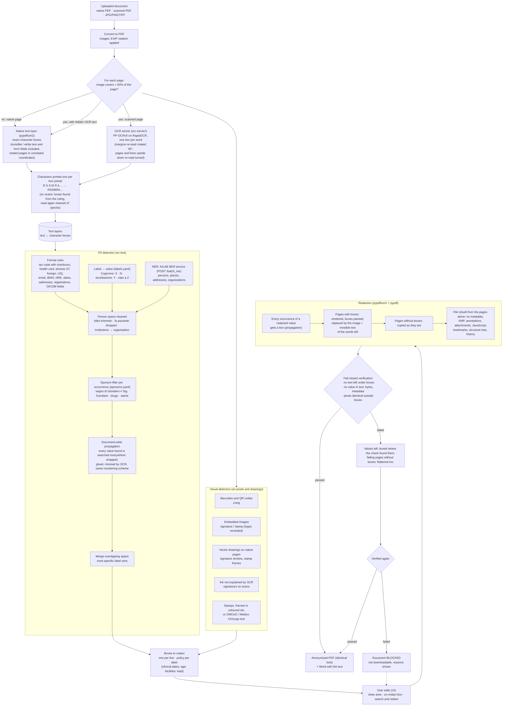

# Anonymization of clinical documents

This service implements chapter **C1 · Anonimizzazione** of the MIA AI evolutions:
a doctor uploads a document (native PDF, scanned PDF, phone photo), the service
finds the personal data and removes it from the file. Pages with personal data
are replaced by an image of themselves with black boxes painted in (layout,
colours and tables look identical; an invisible text layer keeps them
searchable); pages without it stay as they are. Every output is verified before
it can be downloaded (fail-closed). Everything runs on-prem, on open-source
components with permissive licences: the other services are
the OCR server of `ocr-server/`, deployed next to this one, and the AILAB NER
service.

## How it works



### 1. Text layers (`backend/src/services/anonymizer/reader.py`, `layers.py`)

Detection runs on plain text; redaction runs on the PDF. The link is the
**text layer**: page text in which every character keeps its box on the page.
A detected span `(start, end)` becomes one rectangle per line.

- **Native pages**: pypdfium2 (PDFium) reads the PDF text layer with one exact
  box per character, from the font descender to its ascender. Invisible text
  (white, render mode 3) is included because it must be redacted too, and so
  are form-field values and visible annotations (read from a flattened copy).
  Words and lines are built on the page as displayed, so a table on a rotated
  page reads row by row. Words glued by a scanner's OCR layer are split where a
  capitalised word starts inside them ("prevpt:LindaMarshRX-550-2877" ->
  "Linda", "Marsh", "RX-550-2877"; "McDonald", "HbA1c", "SerD" stay whole).
- **Scanned pages** (a full-page image, or images over half of the page, as
  LiteParse classifies them): read whole by the OCR server of `ocr-server/`,
  PP-OCRv5 on RapidOCR (server detector, Latin recogniser, 300 DPI) behind the
  LiteParse OCR API. It returns one box per word; vertical text in the side
  margins (print traces, protocol numbers, wristband labels) is read by a
  second pass on the margin strips rotated by 90 degrees.
- **Orientation** (`ocr-server/`, `engine.py`): RapidOCR's line orientation
  classifier is off. It turned upright lines by 180 degrees, which were then
  read as noise and dropped whole, personal data included (see "OCR choice").
  Instead:
  - a page read with a mean confidence below 0.8 per character is read again
    turned by 180 degrees (a sheet fed upside down); the turned reading is kept
    only when it is both confident (0.8) and richer, its boxes mapped back with
    the reading direction right to left;
  - on an upright page, a line read below 0.5 is noise or text upside down (a
    patient label pasted the wrong way). The detector cuts such a line into
    pieces, so each low line is grouped with the unsure pieces next to it on its
    band (below 0.8) and the group is read again turned, as one crop
    (recognition only): a reading of at least 0.8 takes its place, otherwise the
    low lines are dropped (as RapidOCR did) and the unsure pieces kept. Lines
    read with confidence are never touched.
- A scan that also carries a hidden OCR layer gets both layers: the hidden text
  is redacted where it overlaps the findings.
- Lines are rebuilt from geometry (`group_lines`): each word is chained to its
  nearest neighbour on the same line, and lines are ordered in reading order,
  so table cells stay apart and a label comes before its value.
- Characters printed one per box (codice fiscale or tessera sanitaria on forms,
  "R S S M R A ...") are joined into one word whose character boxes are the
  cells (`merge_cells`), on native and OCR layers, so the rules see the code.
  Only capitals and digits are joined: the single-letter words of prose stay apart.
- **Character boxes on scans** (`cells.py`, OpenCV). Read as a page, every box
  is a separate word, and scanner specks inside the boxes come back as ".C",
  "i7", "[1" or a lower-case "s", which break the run. The boxes are found from
  the ruling of the form: adaptive threshold, a morphological opening with a
  30 pt horizontal element keeps the ruling lines, and between two lines 7 to
  30 pt apart the columns inked over 80% of the height are the borders; a row
  is at least 5 evenly sized boxes (0.4 to 1.8 times as wide as high). A row
  more than 35% inked inside is a title bar, not boxes. Boxes whose border was
  not seen are added along the ruling while they hold a character, snapped to
  the borders seen, with at most one box per side lacking its border (a faint
  outer border lost on the scan); past it the ruling runs over a table or text. Each
  box is cleaned (Otsu threshold, connected components: only strokes at least a
  quarter of the box high are kept) and the characters are set side by side,
  3 pt apart, into one word that the recogniser reads far better than isolated
  characters ("1" alone comes back as "(i:", "99" without the gap as "9"). The
  reading replaces the page OCR of the row only when it has one capital or digit
  per box with a confidence of at least 0.5, when the row holds the whole code
  (no word of the page OCR runs out of it, no single character is read right
  next to it: a row seen in part is left alone) and when the page OCR did not
  already read a valid code there (codice fiscale, tessera sanitaria, STP/ENI)
  that the clean reading is not. The composed word is read by the OCR server
  (`POST /recognize`, recognition only); boxes are read again only on scanned
  pages read upright.
- Grayscale pictures embedded in a native page (X-ray, CT, ultrasound, an
  embedded scan) stay visible; the text burned into them (patient name, ID,
  date of birth, operator, accession number) is read by the same server, only
  the words inside the picture are kept, and they are redacted like on a scan. Colour
  photos may show a person and are redacted whole (FACE).

The visual detectors work on pypdfium2 page views (`pdf_pages.py`). Components,
open points and licences: [PDF_BACKEND_GAPS.md](PDF_BACKEND_GAPS.md).

### 2. Detection (`backend/src/services/anonymizer/detect/`)

Recall first: one detector is enough to redact.

| Detector | What it finds |
|---|---|
| `rules.py` | Formats: codice fiscale (strict with checksum, plus an OCR-tolerant pattern), tessera sanitaria, phones (Italian, foreign "+234 ...", North American, extensions; never across lines, dates excluded), email, IBAN, URLs with personal tokens, dates (date of birth from context, also ISO, compact and "30-Nov-1966"), age, street addresses, CAP + municipality, professional registrations ("OMCeO MI n.", "Ord. Med. RN n.", "Albo PE n."), NRE, DICOM header fields ("(0010,0010) PatientName", also with the keyword split into words), places and names in typical phrasings |
| `labels.py` + `labels.yaml` | The value after a label: about 60 groups of Italian and English form and report labels ("Cognome:", "COGNOME / SURNAME" with the value below, "N. accettazione", "Prenotazione CUP", "Medicaid ID", "Permesso di soggiorno", "Medico curante", "Mediatore linguistico") with the shape of the value (name, place, address, organisation, identifier, date, phone). A single word after a generic role label ("Medico Ostetrico") needs ":" or capitals. A label with no value on its line takes the next line only if that line is not a sentence ("Mediatore linguistico:" followed by "Acconsento al test HIV" is not a name). An address needs a street type, "c/o" or "presso", a number, or the shape of a place name ("San Giovanni in Fiore"), so prose after "domicilio" is not one. |
| `ner.py` | Client of the AILAB NER service (`POST /batch_ner`, one request per page, chunks of whole lines). Entity groups mapped to the taxonomy (NOME/COGNOME -> PERSON, LUOGO, INDIRIZZO, RAGIONE_SOCIALE ...), the others ignored; adjacent name and surname joined. The service preprocesses the text (eponyms become `EPONYMn`, emails a placeholder), so its offsets drift: word pieces are joined first ("Mo" + "##cenigo"), then each entity is checked against the original text and moved to the nearest occurrence of its word, or dropped. The service reads line breaks as spaces: a span is cut where the next line starts another field ("Grippo" + "Visto:", a stop word of `labels.yaml`, punctuation), while a value wrapped on two lines stays whole. Timeouts, connection errors and 502/503/504 are retried (`ANONPIP_NER_RETRIES`, waits doubling from `ANONPIP_NER_RETRY_BACKOFF_SECONDS`); then fail-closed: a service down fails the job. See "NER" |
| `eponyms.py` + `eponyms.yaml`, `allowlist.py` | Per occurrence: eponyms and scales are not persons only in a clinical context ("segno di Giordano negativo", "Glasgow 15", "Wolff-Parkinson-White"), drug brands never are, common words only in lowercase ("globuli rossi"); "Sig. Giordano" stays a person. About 400 eponyms, 50 scales, 200 drug brands. Plus saints in facility names and clinical vocabulary |
| `ensemble.py` | Person spans lose leading titles, references without a name ("la paziente") are dropped, institution names become organisations. Document-wide propagation: every name token and every redacted identifier found anywhere is searched in every layer (spaced, glued, with initials, both orders, wrapped on two lines); words ambiguous on their own (three letters or fewer, acronyms, field labels, eponyms, scales, Italian municipalities: "Ugo", "HIV", "Masson", "Napoli") are spread only as part of the full name, never alone. Also found: a surname glued to an initial in capitals ("TOKAFOR"), a full name glued to what follows ("LindaMarshRX-550"), OCR confusions 0/o, 1/l, 5/s in names and numbers ("Adebay0", "389 555 773l"), and other codes of the numbering scheme of a found identifier ("RX-550-2913" -> "RX-550-2877"). Names and places with stray symbols or numbers-only words are OCR fragments; addresses from NER need the shape of an address; facility names are organisations. Overlapping spans merge into the most specific label |
| `visual.py` | Barcodes and QR codes (zxing), embedded images (signature or stamp; grayscale clinical pictures left to OCR, colour photos redacted whole; header logos excluded), vector signatures and stamp frames on native pages, on scans the ink that OCR does not explain (signatures), stamps (frame, coloured ink, or a cluster of words around "OMCeO" / "Medico Chirurgo") |

### 3. PII taxonomy (`backend/src/services/anonymizer/taxonomy.py`)

| Label | Kind | Redacted by default |
|---|---|---|
| PERSON, FISCAL_CODE, HEALTH_CARD, ID_DOCUMENT, DATE_OF_BIRTH | text | yes |
| ADDRESS, LOCATION, PHONE, EMAIL | text | yes |
| MEDICAL_RECORD, PRESCRIPTION_ID, PROFESSIONAL_ID, IBAN, URL | text | yes |
| AGE, DATE (clinical dates), ORGANIZATION | text | no (quasi-identifiers, configurable) |
| SIGNATURE, STAMP, BARCODE, QRCODE, FACE, HANDWRITING | visual | yes |

What each label covers (detectors and reviewers apply the same definition):

| Label | Covers |
|---|---|
| `PERSON` | Names of patient, relatives, caregivers, doctors and staff, in any form (BIANCHI GIOVANNI, Bianchi G., Sig. Bianchi, Dott.ssa Ferri). Not eponyms (morbo di Crohn). |
| `FISCAL_CODE` | Codice fiscale of any person (patient or doctor), 16 characters with check char. |
| `HEALTH_CARD` | Tessera sanitaria / TEAM number (20 digits, starts with 80380). |
| `ID_DOCUMENT` | Identity card, passport, driving licence, permit numbers. |
| `DATE_OF_BIRTH` | Date of birth of a person. |
| `AGE` | Age; identifying above 89. |
| `ADDRESS` | Street address, house number, postcode of a person. |
| `LOCATION` | Birthplace, city/province of residence of a person. |
| `PHONE` | Phone, mobile and fax numbers of persons. |
| `EMAIL` | Email and PEC addresses of persons. |
| `MEDICAL_RECORD` | Nosologico, cartella clinica, MRN, accession number, sample ID, episode/admission number, report number. |
| `PRESCRIPTION_ID` | NRE (numero ricetta elettronica), ricetta number. |
| `PROFESSIONAL_ID` | OMCeO registration number, regional doctor code, doctor's CF. |
| `IBAN` | Bank account numbers. |
| `URL` | URLs carrying personal tokens (online report download links). |
| `ORGANIZATION` | Hospital, ward, clinic names (quasi-identifier). |
| `DATE` | Clinical dates: admission, discharge, exam (quasi-identifier). |
| `SIGNATURE` | Handwritten or scanned signatures. |
| `STAMP` | Doctor or facility stamps (timbri), which often contain names and IDs. |
| `BARCODE` | 1D barcodes (Code39/128 on prescriptions: CF, NRE). |
| `QRCODE` | 2D codes (QR, DataMatrix) that may encode personal data or links. |
| `FACE` | Photos of the patient's face. |
| `HANDWRITING` | Handwritten notes. |

### 4. Redaction (`backend/src/services/anonymizer/release.py`)

- **Propagation**: every occurrence of a redacted identifier or full name gets a
  box, also where detection missed it (glued to a label, broken by OCR, in a
  fax header), matched as the output check matches it (whitespace ignored).
  Occurrences the user chose to keep stay visible.
- **Pages with a box** are rendered (pypdfium2, 200 dpi, lossless) as they are
  displayed, the boxes painted in (`ANONPIP_REDACTION_STYLE=label` writes the
  PII type instead of a black box), and replaced by that image on an upright
  page: nothing of their content survives but pixels. An invisible text layer
  with the words that touch no box keeps them searchable.
- **Pages without boxes** are copied as they are.
- **pypdf rebuilds the file from the pages alone**: a fresh catalog, so no
  metadata, XMP, bookmarks, structure tree, named destinations, forms,
  attachments, JavaScript, annotations, page extras or earlier incremental
  versions (a note added and deleted, for example).
- Hand-drawn areas are snapped to the full box of every character they touch.

### 5. Verification (`backend/src/services/anonymizer/verify.py`)

A document is released only if all checks pass:

1. no original text is readable under any box (horizontal and vertical text);
2. no text is left outside the visible page area (it would never be detected
   nor shown, but it would stay in the file);
3. no redacted value (codici fiscali, phones, emails, IDs, full names...) is
   found in the output text, in the decompressed file bytes or in the metadata;
   occurrences the user explicitly chose to keep are not leaks;
4. no annotation is left;
5. rendered pages are identical outside the boxes (more than
   `ANONPIP_VERIFY_PIXEL_TOLERANCE` changed pixels fails; on rotated pages the
   boxes are turned to the rendering first);
6. the Word export contains none of the redacted values either.

**Second pass** (`release.py`). When a check fails, a value still found in the
output text is boxed where the check found it (the words of the output that
spell it), a page without boxes that failed is flattened too, and the file is
rebuilt and verified again; flattened pages are compared with the original as
images at 200 dpi. The result reports which pages were flattened
(`flattened_pages`).

A document that still fails is blocked (409 `VERIFICATION_FAILED`) and the
reasons are shown to the uploader. An edit marks the job unverified at once: nothing
is downloadable until the new version has passed every check (a version that
fails stays blocked; a failed edit leaves the job blocked and says so).

Coordinates: text, image positions and drawings live in page space (unrotated);
anything read from a rendering (OCR words, barcodes, ink) is in display space
and is turned into page space before detection and redaction, so `/Rotate`
pages are redacted where the text really is.

## API

The endpoints follow the document agent of ai-platform-v2 (`/documents/*`): a
session is created by the upload, its work runs inside a POST that streams
Server-Sent Events, and the result is read with `preview` and `download`.

Two modes, chosen at upload with the form field `mode` (default `accurate`):

- **`accurate`**: the whole pipeline above; releases the redacted PDF and a Word
  copy, and supports the side-by-side review with manual edits.
- **`fast`**: the same text layers and text detection (rules, labels, NER,
  propagation), without the visual detectors, the redaction of the PDF and its
  pixel checks; releases only the anonymized text as Markdown (see "Fast mode").

All paths start with `/anonymizations`:

| Method and path | What it does | Modes |
|---|---|---|
| `GET /labels` | Taxonomy: `[{code, title, kind, redact}]` | - |
| `POST /sessions` (multipart `file`, form `mode`) | Store the upload and create the session; 201 with the session (`status: "created"`) | both |
| `GET /sessions/{id}` | The session: `{session_id, mode, status, step, percent, error_code, pages, size, result}` | both |
| `POST /sessions/{id}/anonymize/stream` | Run the anonymization; SSE frames below | both |
| `POST /sessions/{id}/edits/stream` | `{add: [{page, rect}], remove: [box ids], restore: [box ids], search: "text"}`: redaction and verification only, no new detection; SSE frames below | accurate |
| `POST /sessions/{id}/cancel` | Stop at the next step; the session and its files are deleted | both |
| `GET /sessions/{id}/preview` | The released document inline: PDF (accurate) or Markdown (fast) | both |
| `GET /sessions/{id}/download?format=pdf\|docx\|md` | The released document as an attachment (`documento_anonimizzato.<ext>`); default `pdf` (accurate), `md` (fast) | both |
| `GET /sessions/{id}/review` | Manifest of the side-by-side review (see below) | accurate |
| `GET /sessions/{id}/pages/original/{page}?dpi=` | PNG of the original page | both |
| `GET /sessions/{id}/pages/anonymized/{page}?dpi=` | PNG of the anonymized page | accurate |
| `DELETE /sessions/{id}` | Delete now | both |

**Streams.** Each frame is `event: <name>` plus a JSON `data` line:

| Event | Data |
|---|---|
| `status` | `{step, percent, text}`: `read`, `detect`, `redact`, `preview` (accurate) or `export` (fast), with an Italian `text` |
| `done` | Anonymization: `{session, elapsed_ms}`. Edit: `{session, search_hits, edit_seconds, elapsed_ms}` |
| `error` | `{error_title, error_message, error_code}`, generic Italian title and message |

The stream of a finished session answers `done` at once. A session already
being anonymized or edited answers `error` `SESSION_BUSY`. A client that
disconnects stops only its stream: the work goes on, and `GET /sessions/{id}`
reports it. Error codes in the frames: `NER_UNAVAILABLE` or
`SERVICE_UNAVAILABLE` when a dependency was down (retry later),
`PROCESSING_FAILED`, `CANCELLED`, `SESSION_BUSY`, `JOB_NOT_FOUND` (deleted
during an edit).

A whole run from a shell (`-N` shows the frames as they arrive):

```bash
B=http://127.0.0.1:8000/anonymizations/sessions
ID=$(curl -s -F file=@referto.pdf -F mode=accurate $B | jq -r .session_id)
curl -N -X POST $B/$ID/anonymize/stream          # status ... status, then done
curl -N -X POST -H 'Content-Type: application/json' \
     -d '{"search": "Medicina Interna"}' $B/$ID/edits/stream
curl -o anonimizzato.pdf "$B/$ID/download?format=pdf"
curl -X DELETE $B/$ID
```

**Releases are fail-closed.** `preview` and `download` answer 409
`VERIFICATION_FAILED` when verification failed, `JOB_NOT_READY` before the end
or while an edit replaces the files, and 404 `JOB_NOT_FOUND` when the session
expired or was deleted in the meantime. An action of the other mode answers
409 `MODE_NOT_SUPPORTED`.

### Side-by-side review (frontend contract)

1. `POST /anonymizations/sessions` with `mode=accurate`, then
   `POST /anonymizations/sessions/{id}/anonymize/stream` until the `done` frame.
2. `GET /anonymizations/sessions/{id}/review`:

   ```json
   {
     "session_id": "<32 hex>", "mode": "accurate", "version": 0, "verified": true,
     "pages": [{"index": 0, "width": 595.0, "height": 842.0,
                "original": "/anonymizations/sessions/<id>/pages/original/0",
                "anonymized": "/anonymizations/sessions/<id>/pages/anonymized/0?v=0"}],
     "boxes": [{"id": 0, "page": 0, "rect": [40.0, 92.1, 120.5, 103.0],
                "label": "PERSON", "layer": "native", "redact": true}],
     "labels": {"PERSON": "Nomi", "FISCAL_CODE": "Codice fiscale"}
   }
   ```

   - Original on the left, anonymized on the right: the two image URLs, relative
     to the service root; `dpi` (50..200, default 110) may be added.
   - `width`/`height` and `rect` are PDF points, top-left origin, as the page is
     displayed: scale by `image_width_px / width` to draw the boxes on the image.
   - Boxes carry no text: the value is visible on the original page.
   - `version` changes with every edit, and so do the anonymized URLs (no stale cache).
3. The reviewer draws a rectangle on the original page to redact it, or clicks a
   box to remove or restore it: `POST /sessions/{id}/edits/stream` with `add`
   (rectangles in the same space as `rect`), `remove` / `restore` (box ids). The
   `done` frame carries the new result; `GET /sessions/{id}/review` again gives
   the new boxes and URLs.
4. `GET /sessions/{id}/download` (or `?format=docx`) once `verified` is true and
   no edit is running.

### Fast mode (`backend/src/services/anonymizer/export_markdown.py`)

The text is the one of the Word export (native layer, or OCR on scanned pages),
line by line, with:

- `<!-- pagina N -->` before every page;
- every redacted value replaced by its label tag: `[NOME]`, `[CODICE FISCALE]`,
  `[INDIRIZZO]`, ... (`taxonomy.py`, column `tag`);
- every table found by LiteParse (`extract_blocks`, ruled or borderless) as a
  Markdown table, first row as header, each cell anonymized like any other text
  (`| [NOME] | [CODICE FISCALE] | negativo |`). When some text inside the table
  falls in no cell, the table is exported as lines instead: no text is lost;
- `[IMMAGINE]` in place of every figure, in reading order: pictures are not
  read in fast mode.

Before release, no redacted identifier or full name may appear in the file
(`verify_markdown`, the same check as the Word export); otherwise the download
is refused. Scanned pages have no LiteParse blocks: their OCR text, tables
included, is exported line by line.

Errors are `ServiceError` subclasses with generic Italian messages (`errors.py`):
`UNSUPPORTED_FORMAT` 415, `FILE_TOO_LARGE` 413, `TOO_MANY_PAGES` 413,
`UNREADABLE_DOCUMENT` 422, `PASSWORD_PROTECTED` 422, `TOO_MANY_JOBS` 429,
`JOB_NOT_FOUND` 404, `JOB_NOT_READY` 409, `MODE_NOT_SUPPORTED` 409,
`VERIFICATION_FAILED` 409; in the SSE frames also `SESSION_BUSY`,
`PROCESSING_FAILED`, `CANCELLED`.

## Sessions and privacy (`backend/src/services/anonymization.py`)

- One job at a time (single worker); edits go
  through the same worker.
- Documents live in a private folder (`0700`) only while the job exists; they
  are deleted after `ANONPIP_JOB_TTL_MINUTES`, on `DELETE`, on cancel and on shutdown.
- Jobs are in memory: with more than one replica, the ingress needs session
  affinity, or the deployment runs one replica (see `DEPLOY_HANDOVER.md`).
- URLs carry only random 32-hex job ids. Downloads have a generic name
  (`documento_anonimizzato.pdf`): the original file name may contain the patient's name.
- Logs never contain text, values or file names. Processing errors log only the
  exception type.

### KPI events (contract with KPI-dashboard)

Names and keys are unchanged by the session API: `job_id` is the session id.

| Event | Keys |
|---|---|
| `anonymization_job_created` | `job_id`, `pages`, `size_kb`, `source_format`, `mode` |
| `anonymization_completed` | `job_id`, `pages`, `scanned_pages`, `boxes`, `values_by_label`, `verified`, `edits`, `seconds_total`, `timings`, `mode` |
| `anonymization_edited` | `job_id`, `added`, `removed`, `restored`, `search_hits`, `verified`, `seconds` |
| `anonymization_failed` | `job_id`, `error` (exception type) |
| `anonymization_cancelled` | `job_id` |
| `anonymization_job_deleted` | `job_id`, `reason` (`user`, `expired`) |

`backend/tests/utils/test_logging_setup.py` pins the keys and checks that no PII reaches the logs.

## Synthetic dataset and evaluation

The scoring is the evaluation CLI of `backend/evals/` (`just backend::evaluate`,
`just backend::eval-compare`). What follows describes the dataset, the metrics and the results.

**Dataset**: seven Italian document types (discharge
letter, lab report, radiology report, ER report, referral letter, sick-leave
certificate, electronic prescription), each in three variants: native PDF,
scan (skew, paper tint, noise, blur, JPEG, some in grayscale) and scan with
an invisible OCR layer. Traps: names in coloured headers, repeated footers and
rotated margin text, invisible white text, metadata, an annotation deleted but
still in the file history, patients whose surname is an eponym (Corti, Pacini,
Morgagni), eponyms, drugs, signatures, stamps, barcodes with the codice fiscale
and NRE, QR codes with personal URLs, PII in table cells.

Ground truth is exact and fair: each document is rendered twice from the same
seed. In the first copy every PII mention is drawn in a colour that encodes its
id (offset of at most 15/255 from black or white), which gives the box of every
mention, including inside tables and rotated text; that copy is then deleted.
The dataset PDF is the second, clean copy, with pure colours: a check asserts
that both copies have identical words and positions. Ground truth lives in
`dataset/ground_truth/`, separate from the inputs.

**Evaluation dataset** (`dataset/`): 200 documents (326 pages), each in the
three variants above with ground truth in the same format: 600 PDFs.
185 are Italian and 15 English. The test split (`--split test`) holds the
held-out documents: the split is fixed by template family
(about 30% of the families, 77 documents), so no sibling of a test document
is ever seen while tuning; `--split dev` is the rest (123 documents). The
`doc_id` prefix tells the sources apart:

| Prefix | Documents | Content |
|---|---|---|
| `NNN_` | 42 | the seven synthetic types above, 6 of each |
| none | 96 | eight Italian report types in three difficulty levels (facile, media, complessa): repeated headers and footers, codice fiscale in character boxes, stamps, signatures, barcodes and QR codes, eponyms. Boxes recovered from a value-level ground truth; clinical content (diagnoses, drugs, lab values) is not PII, so redacting it counts as over-redaction |
| `eNNN_` | 56 | edge cases: fax with the codice fiscale in character boxes, phone photo with perspective and handwritten PII, landscape table on a `/Rotate 90` page, PII in AcroForm fields, X-ray with PII burned into the pixels and a DICOM header dump, handwritten note on a scan plus the same scan with an OCR layer, PII in metadata, attachments, sticky notes, white text, text under an image and a 2 pt footer, surnames that are cities or words, foreign patients (STP/ENI, passports, diacritics), US and UK documents |
| `d3_` | 6 | hand-annotated worst cases: mixed scanned and native pages, phone photo, fax, hidden channels, US forms |

The dataset is not in git and not in the repository: copy the gold set into
`dataset/` before an evaluation (only the `NNN_` documents can be regenerated). On the documents whose native PDF is
already an image (fax, photo, scans) the `scan_ocr` variant has no OCR layer.

**Evaluation** (metrics from standard libraries):

| Metric | Definition | Library |
|---|---|---|
| Recall, precision, F1 (box) | Every required ground-truth box is a positive, found when redaction boxes cover at least 75% of it (honorific excluded; below that part of the value may stay readable); every redaction box touching no ground truth is a false positive; boxes on quasi-identifiers only (clinical dates, facility data) are ignored | scikit-learn |
| Precision, recall, F1, accuracy (word) | Every word of the page: PII or not, redacted or not; quasi-identifiers skipped. The only level with true negatives, hence the only meaningful accuracy. On scans the words of the native twin are mapped through the transform the generator applied | scikit-learn |
| AP@0.5 (PII) | COCO average precision, IoU 0.5, detections ranked by their confidence score, label-agnostic (PII vs not), quasi-identifiers as `iscrowd` ignore regions, each page an image | torchmetrics (pycocotools) |
| mAP@0.5 | Mean of the per-label AP@0.5 (the predicted label must match) | torchmetrics (pycocotools) |

Plus hidden PII leaked (white text, metadata, deleted notes), eponyms wrongly
redacted, verified documents and seconds per page.

Results on the whole evaluation set (200 documents x 3 variants, 600 PDFs;
22/10/2026), with the AILAB NER service and the OCR server on a laptop RTX 5070
(8 GB):

| | native | scan | scan + OCR layer |
|---|---|---|---|
| Recall (box, required PII) | 0.940 | 0.918 | 0.933 |
| Precision (box) | 0.954 | 0.926 | 0.872 |
| F1 (box) | 0.947 | 0.922 | 0.902 |
| Precision / recall / F1 (word) | 0.941 / 0.952 / 0.946 | 0.785 / 0.941 / 0.856 | 0.737 / 0.954 / 0.832 |
| Accuracy (word) | 0.986 | 0.960 | 0.951 |
| AP@0.5 (PII, label-agnostic) | 0.663 | 0.595 | 0.519 |
| mAP@0.5 (mean over PII types) | 0.674 | 0.582 | 0.568 |
| Hidden PII leaked (white text, metadata, OCR layers) | 1/324 | n/a | 0/324 |
| Boxes with no PII (over-redaction) | 305 | 494 | 922 |
| Eponyms wrongly redacted | 65/415 | 77/415 | 108/415 |
| Documents passing verification | 200/200 | 200/200 | 200/200 |
| Seconds per page | 0.75 | 2.54 | 2.67 |

Recall per type (native / scan / scan + OCR layer):

| Type | Recall | Type | Recall |
|---|---|---|---|
| PERSON | 96% / 96% / 97% | FISCAL_CODE | 99% / 94% / 96% |
| HEALTH_CARD | 100% / 100% / 100% | DATE_OF_BIRTH | 93% / 91% / 92% |
| ADDRESS | 96% / 93% / 94% | LOCATION | 94% / 93% / 94% |
| PHONE | 93% / 90% / 92% | EMAIL | 92% / 87% / 95% |
| MEDICAL_RECORD | 79% / 74% / 76% | PRESCRIPTION_ID | 90% / 92% / 92% |
| PROFESSIONAL_ID | 88% / 94% / 94% | ID_DOCUMENT | 91% / 70% / 91% |
| IBAN, URL, QRCODE | 100% everywhere | BARCODE | 97% / 100% / 100% |
| SIGNATURE | 97% / 89% / 89% | STAMP | 96% / 97% / 97% |
| HANDWRITING | 0% (0 of 21) | | |

The hidden value left is a name in a hidden channel of a native document
("Linda Marsh" in `d3_L04_radiology_report_native_hidden_channels`), which the
NER service does not find (see "Known limits"). `--split test` scores only the
77 held-out documents.

Reading the numbers:

- Recall is the safety metric (a missed value is a leak); precision measures
  over-redaction, mostly facility addresses and phones in the headers.
- MEDICAL_RECORD is the weakest text type: among the misses are internal
  record, accession and authorisation numbers with no label, or with a label
  `labels.yaml` does not know ("R.G. 2187/2024", "CDA-OSP-26-4471").
- On plain scans identity documents (70%) and codici fiscali (94%, against 99%
  on native pages) lose to OCR: the same documents read from their text layer
  score higher.
- AP is lower than recall because it also scores localisation (IoU 0.5) and
  ranking, which redaction does not need. On scans with a hidden OCR layer the
  boxes of that layer are misaligned with the visible text: they are real
  redactions, but AP counts them as duplicate detections (NMS cannot merge
  boxes that overlap less than 0.5). On scans signatures are covered by an ink
  box smaller than the image box of the ground truth. Address, CAP and city are
  annotated separately but often detected as one box.
- Per-type AP and every miss are listed in the report the evaluation writes
  (`reports/evaluation.md`); `just backend::eval-compare` compares two runs.

## OCR choice

Measured in October 2026 on the 120 scanned documents of the dev split, with
only the OCR changing (a box is found when redaction covers 75% of it), on a
laptop RTX 5070 (8 GB) with nothing else running:

| OCR | Recall | Missed PII boxes | Precision | F1 | AP@0.5 / mAP@0.5 | s/page |
|---|---|---|---|---|---|---|
| docTR (db_resnet50 + parseq) | 0.875 | 535 | 0.947 | 0.909 | 0.597 / 0.512 | 1.8 |
| **PaddleOCR PP-OCRv5, server detector (RapidOCR)** | **0.900** | **426** | 0.947 | **0.923** | 0.584 / **0.571** | 4.0 |
| PaddleOCR PP-OCRv6 medium (official package), first 90 documents | 0.750 | | 0.897 | | | 2.4 |

PaddleOCR PP-OCRv5 with the server detector is the one in use: one missed value
in five fewer than docTR at the same precision. Its label-agnostic AP is
slightly lower because AP also scores box tightness and ranking, which
redaction does not need. It is Apache 2.0. PP-OCRv5 has a larger "server" model
only for detection; the Latin recogniser is the mobile one either way. In the
OCR server (`ocr-server/`, RapidOCR on ONNX Runtime)
`OCRSRV_DET_MODEL=PP-OCRv5_mobile_det` trades some accuracy for speed.

PP-OCRv6 scores higher than v5 in PaddleOCR's own benchmarks, but those are
in-house sets, largely Chinese, compared with the Chinese v5 recogniser. Its
recogniser has one dictionary for 50 languages (18,708 characters, 15,565 of
them Chinese, against 836 Latin characters for the v5 Latin model) and on our
Italian documents it drops the spaces after punctuation ("Salerno,15/03/2026",
"Cod.regionale724932") and adds accents ("Gaglíardǐ"): values glued to their
neighbours are not recognised. The official package also returns line boxes
only, so word boxes have to be estimated.

### Orientation and character boxes

How PP-OCRv5 is run matters as much as the model:

- **The line classifier is off.** RapidOCR can pass every detected line to an
  orientation classifier; on our scans it turned upright, perfectly legible
  lines by 180 degrees ("Paz. Zanetti Carlo Alberto - nato il 30.08.1953 - Acc.
  TC2025-118842", "la cugina Khady Sow (+39 389 0047215)"). The recogniser then
  read noise (confidence about 0.35) and RapidOCR dropped the whole line under
  its 0.5 threshold. Without the classifier the same lines are read at 0.98 to
  0.99. Pages and lines upside down are handled by the OCR server instead (see
  "Text layers").
- **Character boxes are read again cleaned.** Codes in boxes broken by specks
  are read again as one clean word; tessera sanitaria reaches 100% on plain
  scans. The guards described in "Text layers" (the whole row must be found, a
  valid code read by the page OCR is kept) stop a partial row from replacing a
  code read whole.
- **Cost.** Finding the box rows takes about 0.08 s per page; each row and each
  low line read again is one recognition call on a small crop. A page is read
  twice only when its mean confidence is below 0.8, which no page of the
  evaluation set reaches (its lowest is 0.98).
- **Side effects.** More lines read means more text to misjudge: a few eponyms
  more are redacted on scans than on native pages. On upright pages the turned
  re-reading of low lines can add a piece of noise (a signature read as two
  short words) and removes no word read with confidence.

### Speed

- Seconds per page on the evaluation set (table above, laptop RTX 5070, 8 GB,
  OCR server on the GPU, NER in the AILAB service): 0.75 native, 2.5 scan, 2.7
  scan with a hidden OCR layer, verification included.
- **Detector input size**: RapidOCR shrinks every image to a long side of 2000
  px before detection (its `Global.max_side_len`), so a 300 dpi A4 page reaches
  the detector at 1984 x 1408.
- Native pages are not read by OCR, except the pictures on them (X-rays), whose
  burned-in text is read.
- **GPU memory**: only the OCR server uses a GPU; it peaks at about 4 GB per
  page and releases it after every run (0.3 GB idle); an optional cap is
  `OCRSRV_GPU_MEM_LIMIT_MB` (0 = none).

Not adopted:

- **GLM-OCR** (via Ollama) reads stamps and faded fax lines better than docTR
  (0.7 s per crop), but it returns text without boxes: aligned to docTR's word
  boxes on the uncertain lines it changed nothing measurable, for +50% time.
- **LightOnOCR-3** (Apache 2.0, 0.8B): block-level boxes only; text-only use
  would sit in the same place as GLM-OCR.
- **Chandra OCR 2** (5B): block-level layout, and its weights need a commercial
  licence for self-hosting.
- **A contextual LLM detector** (qwen3-vl 8B via Ollama) raised F1 on native
  PDFs from 0.949 to 0.965 on a sample, at about 30 times the time per page.
- **Docling**: document structure (tables, reading order), with OCR delegated
  to an engine like the one above and no word boxes.

## NER

NER is the AILAB NER service of the platform (`ANONPIP_NER_URL`): the pipeline
sends the text of each page and keeps only the entities, never its
`obfuscated_text`. The configuration endpoints of the service
(`/medical_orgs`, `/medical_labels`) are shared with ai-platform and never
called.

Recall depends far more on the rules, the labels and propagation than on the
NER: every type but persons and places comes from the rules. What the service
output still misses on the evaluation set:

- eponyms of its dictionary are replaced before the model, also when they are
  surnames or first names ("Alessia Corti" -> "Alessia EPONYM3", "Vittoria"
  -> "EPONYM2"): the replaced word does not exist in the original text and is
  dropped, so the name is redacted only in part;
- words split into pieces with the middle piece missing ("ME" + "##INA" for
  "MESSINA"), which cannot be aligned;
- foreign names and dense lists of patients (shift handovers) with no entity
  at all ("Emeka Okafor", "Popescu Ioana");
- places with the country in brackets found in part ("Casablanca (Marocco)").

Over-redaction from the service comes from fragments taken for places ("il",
"C", "PUGLIA"), medical eponyms taken for persons ("Marsh-Oberhuber", "Ishak")
and label words joined to names ("CAIRONI DANILO Nato"). Joining word pieces and
cutting spans at the next field (see `ner.py` above) handle part of it; the rest
needs either a change in the service (offsets on the original text, or no
`EPONYM` replacement on the entities) or further filters on our side.

## Known limits

- Handwritten PII on scans is not detected (0 of 21 handwritten boxes in the
  evaluation set): the UI edits cover it. DOCX/TXT input is not supported.
- Reversible mode (encrypted mapping, reconstruction of the original) is out of scope.
- Internal record numbers without a known label (MEDICAL_RECORD, 74% to 79%),
  professional IDs and some phones on plain scans depend on the label
  vocabulary and on OCR quality; the UI edits cover the misses.
- Pages with a box become images: the text stays searchable through an
  invisible layer, but it is not vector text, and native documents grow by
  about 45%.
- Character boxes are found only when their ruling is dark and continuous:
  light grey or red dropout grids, dashed boxes and fax prescriptions are left
  to the page OCR. Boxes tuned on synthetic forms with 14 to 15 pt cells.
- Upside-down pages and lines are handled for 180 degrees only; a page whose
  upside-down reading looks confident (mean above 0.8) is not read again
  turned. Text turned by angles other than 90 and 180 degrees is not handled.
- NER depends on the AILAB NER service: names it replaces as eponyms ("Corti",
  "Vittoria"), foreign names and dense lists of patients can be missed or
  redacted in part (see "NER"); the text of each page leaves the pod for the
  service; if the service is down, jobs fail (fail-closed).
