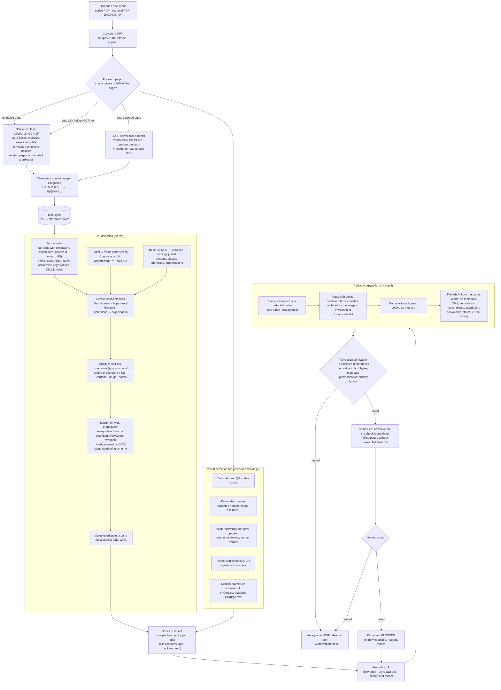

# Anonymization of clinical documents

This service implements chapter **C1 · Anonimizzazione** of the MIA AI evolutions:
a doctor uploads a document (native PDF, scanned PDF, phone photo), the service
finds the personal data and removes it from the file. Pages with personal data
are replaced by an image of themselves with black boxes painted in (layout,
colours and tables look identical; an invisible text layer keeps them
searchable); pages without it stay as they are. Every output is verified before
it can be downloaded (fail-closed). Everything runs on-prem, on open-source
components with permissive licences (no PyMuPDF): the only other service is
the OCR server of `ocr-server/`, deployed next to this one.

## How it works



### 1. Text layers (`services/anonymization/reader.py`, `layers.py`)

Detection runs on plain text; redaction runs on the PDF. The link is the
**text layer**: page text in which every character keeps its box on the page.
A detected span `(start, end)` becomes one rectangle per line.

- **Native pages**: LiteParse (Apache-2.0, PDFium) reads the PDF text layer
  with OCR off, so a hidden layer is never replaced by what OCR sees. It gives
  word boxes; character boxes are interpolated inside them. Invisible text
  (white, render mode 3) is included because it must be redacted too. Words
  that LiteParse splits on text written at 90 degrees are rebuilt from their
  fragments, and words glued by a scanner's OCR layer are split where a
  capitalised word starts inside them ("prevpt:LindaMarshRX-550-2877" ->
  "Linda", "Marsh", "RX-550-2877"; "McDonald", "HbA1c", "SerD" stay whole).
- **Scanned pages** (a full-page image, or images over half of the page): read
  whole by the OCR server of `ocr-server/`, PaddleOCR PP-OCRv5 (server
  detector, Latin recogniser, 300 DPI) behind the LiteParse OCR API. It returns
  one box per word, widened to whole characters; vertical text in the side
  margins (print traces, protocol numbers, wristband labels) is read by a
  second pass on the margin strips rotated by 90 degrees.
- A scan that also carries a hidden OCR layer gets both layers: the hidden text
  is redacted where it overlaps the findings.
- Lines are rebuilt from geometry (`group_lines`): each word is chained to its
  nearest neighbour on the same line, and lines are ordered in reading order,
  so table cells stay apart and a label comes before its value.
- Characters printed one per box (codice fiscale or tessera sanitaria on forms,
  "R S S M R A ...") are joined into one word whose character boxes are the
  cells (`merge_cells`), on native and OCR layers, so the rules see the code.
  Only capitals and digits are joined: the single-letter words of prose stay apart.
- Grayscale pictures embedded in a native page (X-ray, CT, ultrasound, an
  embedded scan) stay visible; the text burned into them (patient name, ID,
  date of birth, operator, accession number) is read through LiteParse's OCR
  call to the same server and redacted line by line like on a scan. Colour
  photos may show a person and are redacted whole (FACE).

The visual detectors work on pypdfium2 page views (`pdf_pages.py`). Measured
against the former PyMuPDF + RapidOCR pipeline, and what is left to do:
[PDF_BACKEND_GAPS.md](PDF_BACKEND_GAPS.md).

### 2. Detection (`services/anonymization/detect/`)

Recall first: one detector is enough to redact.

| Detector | What it finds |
|---|---|
| `rules.py` | Formats: codice fiscale (strict with checksum, plus an OCR-tolerant pattern), tessera sanitaria, phones (Italian, foreign "+234 ...", North American, extensions; never across lines, dates excluded), email, IBAN, URLs with personal tokens, dates (date of birth from context, also ISO, compact and "30-Nov-1966"), age, street addresses, CAP + municipality, professional registrations ("OMCeO MI n.", "Ord. Med. RN n.", "Albo PE n."), NRE, DICOM header fields ("(0010,0010) PatientName", also with the keyword split into words), places and names in typical phrasings |
| `labels.py` + `labels.yaml` | The value after a label: about 60 groups of Italian and English form and report labels ("Cognome:", "COGNOME / SURNAME" with the value below, "N. accettazione", "Prenotazione CUP", "Medicaid ID", "Permesso di soggiorno", "Medico curante", "Mediatore linguistico") with the shape of the value (name, place, address, organisation, identifier, date, phone). A single word after a generic role label ("Medico Ostetrico") needs ":" or capitals. A label with no value on its line takes the next line only if that line is not a sentence ("Mediatore linguistico:" followed by "Acconsento al test HIV" is not a name). An address needs a street type, "c/o" or "presso", a number, or the shape of a place name ("San Giovanni in Fiore"), so prose after "domicilio" is not one. Vocabulary ported from feat/reconstructed-architecture |
| `ner.py` | Two multilingual PII models run together, their findings joined: GLiNER `urchade/gliner_multi_pii-v1` and GLiNER2 `fastino/gliner2-privacy-filter-PII-multi`, labels mapped to the taxonomy, chunks of whole lines. Chosen against four other PII models, see "NER choice" |
| `eponyms.py` + `eponyms.yaml`, `allowlist.py` | Per occurrence: eponyms and scales are not persons only in a clinical context ("segno di Giordano negativo", "Glasgow 15", "Wolff-Parkinson-White"), drug brands never are, common words only in lowercase ("globuli rossi"); "Sig. Giordano" stays a person. About 400 eponyms, 50 scales, 200 drug brands. Plus saints in facility names and clinical vocabulary |
| `ensemble.py` | Person spans lose leading titles, references without a name ("la paziente") are dropped, institution names become organisations. Document-wide propagation: every name token and every redacted identifier found anywhere is searched in every layer (spaced, glued, with initials, both orders, wrapped on two lines); words ambiguous on their own (three letters or fewer, acronyms, field labels, eponyms, scales, Italian municipalities: "Ugo", "HIV", "Masson", "Napoli") are spread only as part of the full name, never alone. Also found: a surname glued to an initial in capitals ("TOKAFOR"), a full name glued to what follows ("LindaMarshRX-550"), OCR confusions 0/o, 1/l, 5/s in names and numbers ("Adebay0", "389 555 773l"), and other codes of the numbering scheme of a found identifier ("RX-550-2913" -> "RX-550-2877"). Names and places with stray symbols or numbers-only words are OCR fragments; addresses from NER need the shape of an address; facility names are organisations. Overlapping spans merge into the most specific label |
| `visual.py` | Barcodes and QR codes (zxing), embedded images (signature or stamp; grayscale clinical pictures left to OCR, colour photos redacted whole; header logos excluded), vector signatures and stamp frames on native pages, on scans the ink that OCR does not explain (signatures), stamps (frame, coloured ink, or a cluster of words around "OMCeO" / "Medico Chirurgo") |

### 3. PII taxonomy (`services/anonymization/taxonomy.py`)

| Label | Kind | Redacted by default |
|---|---|---|
| PERSON, FISCAL_CODE, HEALTH_CARD, ID_DOCUMENT, DATE_OF_BIRTH | text | yes |
| ADDRESS, LOCATION, PHONE, EMAIL | text | yes |
| MEDICAL_RECORD, PRESCRIPTION_ID, PROFESSIONAL_ID, IBAN, URL | text | yes |
| AGE, DATE (clinical dates), ORGANIZATION | text | no (quasi-identifiers, configurable) |
| SIGNATURE, STAMP, BARCODE, QRCODE, FACE, HANDWRITING | visual | yes |

What each label covers (detectors and reviewers apply the same definition):

| Label | Covers |
|---|---|
| `PERSON` | Names of patient, relatives, caregivers, doctors and staff, in any form (BIANCHI GIOVANNI, Bianchi G., Sig. Bianchi, Dott.ssa Ferri). Not eponyms (morbo di Crohn). |
| `FISCAL_CODE` | Codice fiscale of any person (patient or doctor), 16 characters with check char. |
| `HEALTH_CARD` | Tessera sanitaria / TEAM number (20 digits, starts with 80380). |
| `ID_DOCUMENT` | Identity card, passport, driving licence, permit numbers. |
| `DATE_OF_BIRTH` | Date of birth of a person. |
| `AGE` | Age; identifying above 89. |
| `ADDRESS` | Street address, house number, postcode of a person. |
| `LOCATION` | Birthplace, city/province of residence of a person. |
| `PHONE` | Phone, mobile and fax numbers of persons. |
| `EMAIL` | Email and PEC addresses of persons. |
| `MEDICAL_RECORD` | Nosologico, cartella clinica, MRN, accession number, sample ID, episode/admission number, report number. |
| `PRESCRIPTION_ID` | NRE (numero ricetta elettronica), ricetta number. |
| `PROFESSIONAL_ID` | OMCeO registration number, regional doctor code, doctor's CF. |
| `IBAN` | Bank account numbers. |
| `URL` | URLs carrying personal tokens (online report download links). |
| `ORGANIZATION` | Hospital, ward, clinic names (quasi-identifier). |
| `DATE` | Clinical dates: admission, discharge, exam (quasi-identifier). |
| `SIGNATURE` | Handwritten or scanned signatures. |
| `STAMP` | Doctor or facility stamps (timbri), which often contain names and IDs. |
| `BARCODE` | 1D barcodes (Code39/128 on prescriptions: CF, NRE). |
| `QRCODE` | 2D codes (QR, DataMatrix) that may encode personal data or links. |
| `FACE` | Photos of the patient's face. |
| `HANDWRITING` | Handwritten notes. |

### 4. Redaction (`services/anonymization/release.py`)

- **Propagation**: every occurrence of a redacted identifier or full name gets a
  box, also where detection missed it (glued to a label, broken by OCR, in a
  fax header), matched as the output check matches it (whitespace ignored).
  Occurrences the user chose to keep stay visible.
- **Pages with a box** are rendered (pypdfium2, 200 dpi, lossless) as they are
  displayed, the boxes painted in (`ANONPIP_REDACTION_STYLE=label` writes the
  PII type instead of a black box), and replaced by that image on an upright
  page: nothing of their content survives but pixels. An invisible text layer
  with the words that touch no box keeps them searchable.
- **Pages without boxes** are copied as they are.
- **pypdf rebuilds the file from the pages alone**: a fresh catalog, so no
  metadata, XMP, bookmarks, structure tree, named destinations, forms,
  attachments, JavaScript, annotations, page extras or earlier incremental
  versions (a note added and deleted, for example).
- Hand-drawn areas are snapped to the full box of every character they touch.

### 5. Verification (`services/anonymization/verify.py`)

A document is released only if all checks pass:

1. no original text is readable under any box (horizontal and vertical text);
2. no text is left outside the visible page area (it would never be detected
   nor shown, but it would stay in the file);
3. no redacted value (codici fiscali, phones, emails, IDs, full names...) is
   found in the output text, in the decompressed file bytes or in the metadata;
   occurrences the user explicitly chose to keep are not leaks;
4. no annotation is left;
5. rendered pages are identical outside the boxes (more than
   `ANONPIP_VERIFY_PIXEL_TOLERANCE` changed pixels fails; on rotated pages the
   boxes are turned to the rendering first);
6. the Word export contains none of the redacted values either.

**Second pass** (`release.py`). When a check fails, a value still found in the
output text is boxed where the check found it (the words of the output that
spell it), a page without boxes that failed is flattened too, and the file is
rebuilt and verified again; flattened pages are compared with the original as
images at 200 dpi. The result reports which pages were flattened
(`flattened_pages`).

A document that still fails is blocked (409 `VERIFICATION_FAILED`) and the
reasons are shown to the uploader. An edit marks the job unverified at once: nothing
is downloadable until the new version has passed every check (a version that
fails stays blocked; a failed edit leaves the job blocked and says so).

Coordinates: text, image positions and drawings live in page space (unrotated);
anything read from a rendering (OCR words, barcodes, ink) is in display space
and is turned into page space before detection and redaction, so `/Rotate`
pages are redacted where the text really is.

## API

| Method and path | What it does |
|---|---|
| `POST /anonymizations` (multipart `file`) | Upload and start; 202 with the job id |
| `GET /anonymizations/{id}` | State; includes the result when done |
| `GET /anonymizations/{id}/events` | Server-Sent Events: one message per progress change, then the final state |
| `POST /anonymizations/{id}/cancel` | Stop at the next step; files deleted |
| `POST /anonymizations/{id}/edits` | `{add: [{page, rect}], remove: [box ids], restore: [box ids], search: "text"}`: redaction and verification only, no new detection |
| `GET /anonymizations/{id}/pages/{original\|anonymized}/{page}?dpi=` | PNG preview |
| `GET /anonymizations/{id}/download/{pdf\|docx}` | Anonymized document (refused when not verified) |
| `DELETE /anonymizations/{id}` | Delete now |
| `GET /anonymizations/labels` | Taxonomy with Italian names |
| `GET /` | Demo web page, only with `ANONPIP_UI_ENABLED=true` |

Errors are `ServiceError` subclasses with generic Italian messages (`errors.py`):
`UNSUPPORTED_FORMAT` 415, `FILE_TOO_LARGE` 413, `TOO_MANY_PAGES` 413,
`UNREADABLE_DOCUMENT` 422, `PASSWORD_PROTECTED` 422, `TOO_MANY_JOBS` 429,
`JOB_NOT_FOUND` 404, `JOB_NOT_READY` 409, `VERIFICATION_FAILED` 409.

## Jobs and privacy (`services/jobs.py`)

- One job at a time (single worker: OCR and NER share the GPU); edits go
  through the same worker.
- Documents live in a private folder (`0700`) only while the job exists; they
  are deleted after `ANONPIP_JOB_TTL_MINUTES`, on `DELETE`, on cancel and on shutdown.
- Jobs are in memory: with more than one replica, the ingress needs session
  affinity, or the deployment runs one replica (see `DEPLOY_HANDOVER.md`).
- URLs carry only random 32-hex job ids. Downloads have a generic name
  (`documento_anonimizzato.pdf`): the original file name may contain the patient's name.
- Logs never contain text, values or file names. Processing errors log only the
  exception type.

### KPI events (contract with KPI-dashboard)

| Event | Keys |
|---|---|
| `anonymization_job_created` | `job_id`, `pages`, `size_kb`, `source_format` |
| `anonymization_completed` | `job_id`, `pages`, `scanned_pages`, `boxes`, `values_by_label`, `verified`, `edits`, `seconds_total`, `timings` |
| `anonymization_edited` | `job_id`, `added`, `removed`, `restored`, `search_hits`, `verified`, `seconds` |
| `anonymization_failed` | `job_id`, `error` (exception type) |
| `anonymization_cancelled` | `job_id` |
| `anonymization_job_deleted` | `job_id`, `reason` (`user`, `expired`) |

`tests/unit/test_logging.py` pins the keys and checks that no PII reaches the logs.

## Web UI (`web/static/index.html`)

A single page following the MIA mockups (Italian, it is shown to doctors):
upload, live progress over SSE with cancel, original with the detections next
to the anonymized document, chips per data type, processing time per step,
edits (draw an area, click a box to un-redact or restore, search and redact),
PDF and Word download, error card. It is for local testing and demos:
in the platform the doctor-facing frontend is `fe`.

## Synthetic dataset and evaluation (`tools/`)

Dev-only tools, not part of the image (`just dataset`, `just evaluate`, `just eval-ui`).

**Dataset** (`tools/dataset/`): seven Italian document types (discharge
letter, lab report, radiology report, ER report, referral letter, sick-leave
certificate, electronic prescription), each in three variants: native PDF,
scan (skew, paper tint, noise, blur, JPEG, some in grayscale) and scan with
an invisible OCR layer. Traps: names in coloured headers, repeated footers and
rotated margin text, invisible white text, metadata, an annotation deleted but
still in the file history, patients whose surname is an eponym (Corti, Pacini,
Morgagni), eponyms, drugs, signatures, stamps, barcodes with the codice fiscale
and NRE, QR codes with personal URLs, PII in table cells.

Ground truth is exact and fair: each document is rendered twice from the same
seed. In the first copy every PII mention is drawn in a colour that encodes its
id (offset of at most 15/255 from black or white), which gives the box of every
mention, including inside tables and rotated text; that copy is then deleted.
The dataset PDF is the second, clean copy, with pure colours: a check asserts
that both copies have identical words and positions. Ground truth lives in
`dataset/ground_truth/`, separate from the inputs.

```bash
just dataset --out dataset_new                 # 21 documents x 3 variants in a new folder
just dataset --n 7 --append                    # add 7 new documents after the existing ones
just dataset --n 42 --overwrite                # regenerate the 42 NNN_ documents of dataset/
just evaluate                                  # -> reports/evaluation.md
```

**Evaluation dataset** (`dataset/`): 200 documents (326 pages), each in the
three variants above with ground truth in the same format: 600 PDFs, scored
with `just evaluate`. 185 are Italian and 15 English. `just evaluate --split test`
scores only the held-out documents: the split is fixed by template family
(about 30% of the 50 families, 77 documents), so no sibling of a test document
is ever seen while tuning; `--split dev` is the rest (123 documents). The `doc_id` prefix tells
the sources apart (`just dataset --overwrite` replaces only the `NNN_` documents):

| Prefix | Documents | Content |
|---|---|---|
| `NNN_` | 42 | the generator above, 6 of each of its 7 types |
| none | 96 | eight Italian report types in three difficulty levels (facile, media, complessa): repeated headers and footers, codice fiscale in character boxes, stamps, signatures, barcodes and QR codes, eponyms. Boxes recovered from a value-level ground truth; clinical content (diagnoses, drugs, lab values) is not PII, so redacting it counts as over-redaction |
| `eNNN_` | 56 | edge cases: fax with the codice fiscale in character boxes, phone photo with perspective and handwritten PII, landscape table on a `/Rotate 90` page, PII in AcroForm fields, X-ray with PII burned into the pixels and a DICOM header dump, handwritten note on a scan plus the same scan with an OCR layer, PII in metadata, attachments, sticky notes, white text, text under an image and a 2 pt footer, surnames that are cities or words, foreign patients (STP/ENI, passports, diacritics), US and UK documents |
| `d3_` | 6 | hand-annotated worst cases: mixed scanned and native pages, phone photo, fax, hidden channels, US forms |

The dataset is not regenerable as a whole (only the `NNN_` documents are), so
back up `dataset/` before deleting it. On the documents whose native PDF is
already an image (fax, photo, scans) the `scan_ocr` variant has no OCR layer.

**Viewer** (`just eval-ui`, `tools/viewer.py`, `http://127.0.0.1:8765`, dev only): the
same layout as the demo page, ground truth on the left (found, missed,
quasi-identifiers, hidden, terms that must stay) and the pipeline's boxes on the
right (correct, false positives, on quasi-identifiers, found but not redacted),
or the redacted output. Every document of a variant is listed with its result;
← → move between documents, PagSu/PagGiù between pages, E jumps to the next
document with errors, and the errors of a document are listed and clickable.
`tools/evaluate.py` writes each document's result to
`reports/docs_<variant>/<doc_id>.json` as soon as it is scored, so an evaluation
started from the page ("Avvia valutazione") or with `just evaluate` shows up live,
with running recall, precision and F1; AP/mAP and accuracy appear when the
variant is complete.

**Evaluation** (`tools/evaluate.py`, metrics from standard libraries in `tools/metrics.py`):

| Metric | Definition | Library |
|---|---|---|
| Recall, precision, F1 (box) | Every required ground-truth box is a positive, found when redaction boxes cover at least 75% of it (honorific excluded; below that part of the value may stay readable); every redaction box touching no ground truth is a false positive; boxes on quasi-identifiers only (clinical dates, facility data) are ignored | scikit-learn |
| Precision, recall, F1, accuracy (word) | Every word of the page: PII or not, redacted or not; quasi-identifiers skipped. The only level with true negatives, hence the only meaningful accuracy. On scans the words of the native twin are mapped through the transform the generator applied | scikit-learn |
| AP@0.5 (PII) | COCO average precision, IoU 0.5, detections ranked by their confidence score, label-agnostic (PII vs not), quasi-identifiers as `iscrowd` ignore regions, each page an image | torchmetrics (pycocotools) |
| mAP@0.5 | Mean of the per-label AP@0.5 (the predicted label must match) | torchmetrics (pycocotools) |

Plus hidden PII leaked (white text, metadata, deleted notes), eponyms wrongly
redacted, verified documents and seconds per page.

Results on the whole evaluation set (`just evaluate`: 200 documents x 3
variants, 600 PDFs; 16/10/2026):

| | native | scan | scan + OCR layer |
|---|---|---|---|
| Recall (box, required PII) | 0.948 | 0.915 | 0.943 |
| Precision (box) | 0.971 | 0.938 | 0.906 |
| F1 (box) | 0.959 | 0.926 | 0.924 |
| Precision / recall / F1 (word) | 0.946 / 0.959 / 0.952 | 0.743 / 0.932 / 0.827 | 0.698 / 0.960 / 0.808 |
| Accuracy (word) | 0.988 | 0.950 | 0.942 |
| AP@0.5 (PII, label-agnostic) | 0.689 | 0.582 | 0.508 |
| mAP@0.5 (mean over PII types) | 0.680 | 0.565 | 0.558 |
| Hidden PII leaked (white text, metadata, OCR layers) | 2/324, fixed since | n/a | 4/324, fixed since |
| Eponyms wrongly redacted | 23/415 | 44/415 | 49/415 |
| Documents passing verification | 200/200 | 200/200 | 200/200 |
| Seconds per page (laptop RTX 5070, 8 GB) | 1.2 | 7.6 | 8.0 |

The 6 hidden values left in that run (two hand-annotated worst cases: white
text, a 4 pt footer, a scanner's OCR layer with glued and misread words) are
fixed since: codes of the same numbering scheme, surnames glued to an initial,
glued words split in the text layer, OCR confusions (0/o, 1/l) in propagation.
Run `just evaluate` again to refresh the table; `--split test` scores only the
77 held-out documents.

Reading the numbers:

- Recall is the safety metric (a missed value is a leak); precision measures
  over-redaction, mostly facility addresses and phones in the headers.
- AP is lower than recall because it also scores localisation (IoU 0.5) and
  ranking, which redaction does not need. On scans with a hidden OCR layer the
  boxes of that layer are misaligned with the visible text: they are real
  redactions, but AP counts them as duplicate detections (NMS cannot merge
  boxes that overlap less than 0.5). On scans signatures are covered by an ink
  box smaller than the image box of the ground truth. Address, CAP and city are
  annotated separately but often detected as one box.
- Per-type recall, every miss and AP per type are listed in
  `reports/evaluation.md`; `just eval-ui` shows each of them on the page.

## OCR choice

Measured in October 2026, before the move to LiteParse, on the 120 scanned
documents of the first dev split, with the pipeline of the time (a box is found when redaction covers 75% of it), only the
OCR changing, on a laptop RTX 5070 (8 GB) with nothing else running:

| OCR | Recall | Missed PII boxes | Precision | F1 | AP@0.5 / mAP@0.5 | s/page |
|---|---|---|---|---|---|---|
| docTR (db_resnet50 + parseq), the former default | 0.875 | 535 | 0.947 | 0.909 | 0.597 / 0.512 | 1.8 |
| **PaddleOCR PP-OCRv5, server detector (RapidOCR)** | **0.900** | **426** | 0.947 | **0.923** | 0.584 / **0.571** | 4.0 |
| PaddleOCR PP-OCRv6 medium (official package), first 90 documents | 0.750 | | 0.897 | | | 2.4 |

PaddleOCR PP-OCRv5 with the server detector was chosen: one missed value in
five fewer than docTR at the same precision. Its label-agnostic AP is slightly
lower because AP also scores box tightness and ranking, which redaction does
not need. It is Apache 2.0. PP-OCRv5 has a larger "server" model only for
detection; the Latin recogniser is the mobile one either way. The same models
now run in the OCR server of `ocr-server/` (PaddleOCR 3.x), where
`OCRSRV_DET_MODEL=PP-OCRv5_mobile_det` trades some accuracy for speed.

PP-OCRv6 scores higher than v5 in PaddleOCR's own benchmarks, but those are
in-house sets, largely Chinese, compared with the Chinese v5 recogniser. Its
recogniser has one dictionary for 50 languages (18,708 characters, 15,565 of
them Chinese, against 836 Latin characters for the v5 Latin model) and on our
Italian documents it drops the spaces after punctuation ("Salerno,15/03/2026",
"Cod.regionale724932") and adds accents ("Gaglíardǐ"): values glued to their
neighbours are no longer recognised. The official package also returns line
boxes only, so word boxes have to be estimated.

### Speed

- **Detector input size**: the OCR server caps the long side of the image the
  detector sees at 2400 px (`OCRSRV_DET_LIMIT_SIDE_LEN`); recognition crops the
  full 300 dpi image. Without the cap a 300 dpi page took about 20 s on the
  detector, with it 0.7 s. The cap is the suspected cause of the remaining gap
  on long codes in scans ([PDF_BACKEND_GAPS.md](PDF_BACKEND_GAPS.md)).
- Measured on the 600-PDF gold set (RTX 5070 8 GB, OCR server and NER on the
  same GPU): 1.4 s per native page, 3.0 s per scanned page, 3.3 s per scan with
  an OCR layer, verification included.
- Native pages are not read by OCR, except the pictures on them (X-rays), whose
  burned-in text is read.
- **GPU memory**: GLiNER and GLiNER2 need about 4 GB, the OCR server about 3 GB.
  On a small GPU `ANONPIP_NER2_ENABLED=false` saves time for about 1 point of
  recall less.

Not adopted:

- **GLM-OCR** (via Ollama) reads stamps and faded fax lines better than docTR
  (0.7 s per crop), but it returns text without boxes: aligned to docTR's word
  boxes on the uncertain lines it changed nothing measurable, for +50% time.
- **LightOnOCR-3** (Apache 2.0, 0.8B): block-level boxes only; text-only use
  would sit in the same place as GLM-OCR.
- **Chandra OCR 2** (5B): block-level layout, and its weights need a commercial
  licence for self-hosting.
- **A contextual LLM detector** (qwen3-vl 8B via Ollama) raised F1 on native
  PDFs from 0.949 to 0.965 on a sample, at about 30 times the time per page.
- **Docling**: document structure (tables, reading order), with OCR delegated
  to an engine like the one above and no word boxes.

## NER choice

Six on-premise PII models (open weights, run in the pod, no external call) in
place of the default, on the 108 native documents of the dev split (179-document set), every other
part of the pipeline identical (75% coverage, laptop RTX 5070):

| NER model | Recall | Precision | F1 | AP@0.5 / mAP@0.5 | s/page |
|---|---|---|---|---|---|
| `urchade/gliner_multi_pii-v1` | 0.937 | **0.973** | **0.955** | 0.648 / 0.653 | 0.65 |
| `fastino/gliner2-privacy-filter-PII-multi` (GLiNER2, 2026) | **0.942** | 0.962 | 0.952 | **0.664 / 0.671** | 0.62 |
| `DeepMount00/GLiNER_PII_ITA` (Italian only) | 0.932 | 0.970 | 0.950 | 0.659 / 0.669 | 0.65 |
| `knowledgator/gliner-pii-large-v1.0` | 0.925 | 0.967 | 0.946 | 0.647 / 0.665 | 0.73 |
| `nvidia/gliner-PII` | 0.920 | 0.959 | 0.939 | 0.628 / 0.668 | 0.73 |
| `openai/privacy-filter` (mainly English) | 0.925 | 0.940 | 0.933 | 0.616 / 0.638 | 1.36 |

| **GLiNER + GLiNER2 together** (default) | **0.948** | 0.961 | **0.954** | 0.654 / 0.653 | 0.7 |

No single model beats GLiNER on F1; the two best together find 1.1 points more
recall than GLiNER alone (17% fewer missed values) at the same F1: the extra
boxes are over-redaction, the safe error. Both are multilingual: on the English
documents of the dev split they tie the best (recall 0.964), while the
Italian-only model drops there (0.945). `ANONPIP_NER2_ENABLED=false` keeps
GLiNER only (precision 0.973, recall 0.937). Recall depends far more on the
rules, the labels and propagation than on the NER: the models differ by 2
points at most. GLiNER2 (`gliner2`, Apache 2.0, Fastino) is loaded with
`from_pretrained`, like GLiNER; its API client for Fastino's cloud is never used.

## Known limits

- Handwritten PII on scans is not detected (0 of 12 handwritten boxes in the
  scanned dev documents): the UI edits cover it. DOCX/TXT input is not supported.
- Reversible mode (encrypted mapping, reconstruction of the original) is out of scope.
- Professional IDs and some phones on plain scans depend on OCR quality; the
  UI edits cover the misses.
- Pages with a box become images: the text stays searchable through an
  invisible layer, but it is no longer vector text, and native documents grow
  by about 45%.
