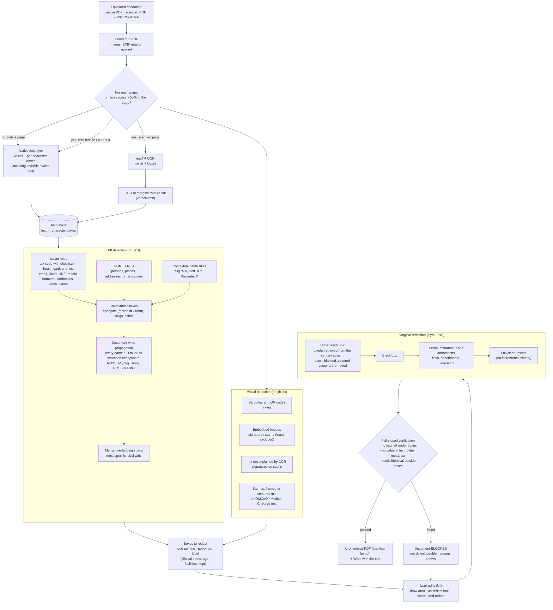

# Surgical anonymization of clinical documents

This service implements chapter **C1 · Anonimizzazione** of the MIA AI evolutions:
a doctor uploads a document (native PDF, scanned PDF, phone photo), the service
finds the personal data and removes it **inside the original file**. Header,
colours, tables, fonts and layout stay identical; only the personal data is
replaced by black boxes. Every output is verified before it can be downloaded
(fail-closed). Everything runs on-prem: no external service is called.

## How it works



### 1. Text layers (`services/anonymization/layers.py`, `ocr.py`)

Detection runs on plain text; redaction runs on the PDF. The link is the
**text layer**: page text in which every character keeps its box on the page.
A detected span `(start, end)` becomes one rectangle per line.

- **Native pages**: words and per-character boxes from the PDF text layer
  (`rawdict`). Invisible text (white, render mode 3) is included because it
  must be redacted too. Words written without space characters (scanner OCR
  layers) are split on visual gaps between characters.
- **Scanned pages** (images cover more than half of the page): docTR
  (`db_resnet50` + `parseq`, 300 DPI) gives word boxes. The per-crop orientation
  classifier is off (it flipped short lines by 180 degrees); vertical text in
  the side margins (print traces, protocol numbers) is read by a second pass on
  the margin strips rotated by 90 degrees.
- A scan that also carries a hidden OCR layer gets both layers: the hidden text
  is redacted where it overlaps the findings.

### 2. Detection (`services/anonymization/detect/`)

Recall first: one detector is enough to redact.

| Detector | What it finds |
|---|---|
| `rules.py` | Codice fiscale (strict with checksum, plus an OCR-tolerant pattern), tessera sanitaria, phones (mobile, landline, fax; dates excluded), email, IBAN, URLs with personal tokens, dates (date of birth from context), age, street addresses, CAP + municipality, OMCeO and regional codes, NRE, record numbers after a keyword (nosologico, campione, accesso, accession, protocollo...), ID documents, places after "nato a", "residente in", "Città:", "a/in + municipality", names after honorifics and form fields ("Sig.ra X", "Paziente: X", "Stampato da X") |
| `ner.py` | GLiNER `urchade/gliner_multi_pii-v1`, zero-shot labels mapped to the taxonomy; chunks of whole lines |
| `allowlist.py` | Eponyms used as such ("morbo di Crohn", "riflesso di Babinski", "organo del Corti"), drugs, saints in facility names, clinical vocabulary. Context decides: "Sig. Corti" and "Concetta Corti" are persons |
| `ensemble.py` | Document-wide propagation: every name token and identifier found anywhere is searched in every layer (spaced, glued, with initials, both orders, capitalised forms only); overlapping spans merge into the most specific label |
| `visual.py` | Barcodes and QR codes (zxing), embedded images (signature or stamp, header logos excluded), on scans the ink that OCR does not explain (signatures), stamps (frame, coloured ink, or a cluster of words around "OMCeO" / "Medico Chirurgo") |

### 3. PII taxonomy (`services/anonymization/taxonomy.py`)

| Label | Kind | Redacted by default |
|---|---|---|
| PERSON, FISCAL_CODE, HEALTH_CARD, ID_DOCUMENT, DATE_OF_BIRTH | text | yes |
| ADDRESS, LOCATION, PHONE, EMAIL | text | yes |
| MEDICAL_RECORD, PRESCRIPTION_ID, PROFESSIONAL_ID, IBAN, URL | text | yes |
| AGE, DATE (clinical dates), ORGANIZATION | text | no (quasi-identifiers, configurable) |
| SIGNATURE, STAMP, BARCODE, QRCODE, FACE, HANDWRITING | visual | yes |

What each label covers (detectors and reviewers apply the same definition):

| Label | Covers |
|---|---|
| `PERSON` | Names of patient, relatives, caregivers, doctors and staff, in any form (BIANCHI GIOVANNI, Bianchi G., Sig. Bianchi, Dott.ssa Ferri). Not eponyms (morbo di Crohn). |
| `FISCAL_CODE` | Codice fiscale of any person (patient or doctor), 16 characters with check char. |
| `HEALTH_CARD` | Tessera sanitaria / TEAM number (20 digits, starts with 80380). |
| `ID_DOCUMENT` | Identity card, passport, driving licence, permit numbers. |
| `DATE_OF_BIRTH` | Date of birth of a person. |
| `AGE` | Age; identifying above 89. |
| `ADDRESS` | Street address, house number, postcode of a person. |
| `LOCATION` | Birthplace, city/province of residence of a person. |
| `PHONE` | Phone, mobile and fax numbers of persons. |
| `EMAIL` | Email and PEC addresses of persons. |
| `MEDICAL_RECORD` | Nosologico, cartella clinica, MRN, accession number, sample ID, episode/admission number, report number. |
| `PRESCRIPTION_ID` | NRE (numero ricetta elettronica), ricetta number. |
| `PROFESSIONAL_ID` | OMCeO registration number, regional doctor code, doctor's CF. |
| `IBAN` | Bank account numbers. |
| `URL` | URLs carrying personal tokens (online report download links). |
| `ORGANIZATION` | Hospital, ward, clinic names (quasi-identifier). |
| `DATE` | Clinical dates: admission, discharge, exam (quasi-identifier). |
| `SIGNATURE` | Handwritten or scanned signatures. |
| `STAMP` | Doctor or facility stamps (timbri), which often contain names and IDs. |
| `BARCODE` | 1D barcodes (Code39/128 on prescriptions: CF, NRE). |
| `QRCODE` | 2D codes (QR, DataMatrix) that may encode personal data or links. |
| `FACE` | Photos of the patient's face. |
| `HANDWRITING` | Handwritten notes. |

### 4. Surgical redaction (`services/anonymization/redact.py`)

PyMuPDF redaction annotations, applied page by page:

- text: the glyphs under the box are deleted from the content stream;
- images: only the pixels under the box are blanked;
- vector art fully inside the box is removed (covered table backgrounds stay);
- a black box is drawn (`ANONPIP_REDACTION_STYLE=label` writes the PII type instead);
- native boxes are inset vertically so neighbouring lines are never clipped;
  hand-drawn areas are snapped to the full box of every character they touch;
- annotations and form fields are deleted, then `scrub()` removes metadata,
  XMP, links, attachments, JavaScript and thumbnails;
- the file is rewritten from scratch (`garbage=4`), so earlier incremental
  versions (a note added and deleted, for example) are gone.

### 5. Verification (`services/anonymization/verify.py`)

A document is released only if all checks pass:

1. no original text is readable under any box;
2. no redacted value (codici fiscali, phones, emails, IDs, full names...) is
   found in the output text, in the decompressed file bytes or in the metadata;
   occurrences the user explicitly chose to keep are not leaks;
3. no annotation is left;
4. rendered pages are identical outside the boxes (more than
   `ANONPIP_VERIFY_PIXEL_TOLERANCE` changed pixels fails).

A failed verification blocks the download (409 `VERIFICATION_FAILED`) and the
reasons are shown to the uploader.

## API

| Method and path | What it does |
|---|---|
| `POST /anonymizations` (multipart `file`) | Upload and start; 202 with the job id |
| `GET /anonymizations/{id}` | State; includes the result when done |
| `GET /anonymizations/{id}/events` | Server-Sent Events: one message per progress change, then the final state |
| `POST /anonymizations/{id}/cancel` | Stop at the next step; files deleted |
| `POST /anonymizations/{id}/edits` | `{add: [{page, rect}], remove: [box ids], restore: [box ids], search: "text"}`: redaction and verification only, no new detection |
| `GET /anonymizations/{id}/pages/{original\|anonymized}/{page}?dpi=` | PNG preview |
| `GET /anonymizations/{id}/download/{pdf\|docx}` | Anonymized document (refused when not verified) |
| `DELETE /anonymizations/{id}` | Delete now |
| `GET /anonymizations/labels` | Taxonomy with Italian names |
| `GET /` | Demo web page, only with `ANONPIP_UI_ENABLED=true` |

Errors are `ServiceError` subclasses with generic Italian messages (`errors.py`):
`UNSUPPORTED_FORMAT` 415, `FILE_TOO_LARGE` 413, `TOO_MANY_PAGES` 413,
`UNREADABLE_DOCUMENT` 422, `PASSWORD_PROTECTED` 422, `TOO_MANY_JOBS` 429,
`JOB_NOT_FOUND` 404, `JOB_NOT_READY` 409, `VERIFICATION_FAILED` 409.

## Jobs and privacy (`services/jobs.py`)

- One job at a time (single worker: OCR and NER share the GPU); edits go
  through the same worker.
- Documents live in a private folder (`0700`) only while the job exists; they
  are deleted after `ANONPIP_JOB_TTL_MINUTES`, on `DELETE`, on cancel and on shutdown.
- Jobs are in memory: with more than one replica, the ingress needs session
  affinity, or the deployment runs one replica (see `DEPLOY_HANDOVER.md`).
- URLs carry only random 32-hex job ids. Downloads have a generic name
  (`documento_anonimizzato.pdf`): the original file name may contain the patient's name.
- Logs never contain text, values or file names. Processing errors log only the
  exception type.

### KPI events (contract with KPI-dashboard)

| Event | Keys |
|---|---|
| `anonymization_job_created` | `job_id`, `pages`, `size_kb`, `source_format` |
| `anonymization_completed` | `job_id`, `pages`, `scanned_pages`, `boxes`, `values_by_label`, `verified`, `edits`, `seconds_total`, `timings` |
| `anonymization_edited` | `job_id`, `added`, `removed`, `restored`, `search_hits`, `verified`, `seconds` |
| `anonymization_failed` | `job_id`, `error` (exception type) |
| `anonymization_cancelled` | `job_id` |
| `anonymization_job_deleted` | `job_id`, `reason` (`user`, `expired`) |

`tests/unit/test_logging.py` pins the keys and checks that no PII reaches the logs.

## Web UI (`web/static/index.html`)

A single page following the MIA mockups (Italian, it is shown to doctors):
upload, live progress over SSE with cancel, original with the detections next
to the anonymized document, chips per data type, processing time per step,
edits (draw an area, click a box to un-redact or restore, search and redact),
PDF and Word download, error card. It is for local testing and demos:
in the platform the doctor-facing frontend is `fe`.

## Synthetic dataset and evaluation (`tools/`)

Dev-only tools, not part of the image (`just dataset`, `just evaluate`, `just bench-ocr`).

**Dataset** (`tools/dataset/`): seven Italian document types (discharge
letter, lab report, radiology report, ER report, referral letter, sick-leave
certificate, electronic prescription), each in three variants: native PDF,
scan (skew, paper tint, noise, blur, JPEG, some in grayscale) and scan with
an invisible OCR layer. Traps: names in coloured headers, repeated footers and
rotated margin text, invisible white text, metadata, an annotation deleted but
still in the file history, patients whose surname is an eponym (Corti, Pacini,
Morgagni), eponyms, drugs, signatures, stamps, barcodes with the codice fiscale
and NRE, QR codes with personal URLs, PII in table cells.

Ground truth is exact and fair: each document is rendered twice from the same
seed. In the first copy every PII mention is drawn in a colour that encodes its
id (offset of at most 15/255 from black or white), which gives the box of every
mention, including inside tables and rotated text; that copy is then deleted.
The dataset PDF is the second, clean copy, with pure colours: a check asserts
that both copies have identical words and positions. Ground truth lives in
`dataset/ground_truth/`, separate from the inputs.

```bash
just dataset                                   # 21 documents x 3 variants -> dataset/
just dataset --n 7 --append                    # add 7 new documents after the existing ones
just dataset --n 21 --seed 42 --out dataset_test --overwrite
just evaluate                                  # -> reports/evaluation.md
```

**Evaluation** (`tools/evaluate.py`, metrics from standard libraries in `tools/metrics.py`):

| Metric | Definition | Library |
|---|---|---|
| Recall, precision, F1 (box) | Every required ground-truth box is a positive, found when redaction boxes cover at least 60% of it (honorific excluded); every redaction box touching no ground truth is a false positive; boxes on quasi-identifiers only (clinical dates, facility data) are ignored | scikit-learn |
| Precision, recall, F1, accuracy (word) | Every word of the page: PII or not, redacted or not; quasi-identifiers skipped. The only level with true negatives, hence the only meaningful accuracy. On scans the words of the native twin are mapped through the transform the generator applied | scikit-learn |
| AP@0.5 (PII) | COCO average precision, IoU 0.5, detections ranked by their confidence score, label-agnostic (PII vs not), quasi-identifiers as `iscrowd` ignore regions, each page an image | torchmetrics (pycocotools) |
| mAP@0.5 | Mean of the per-label AP@0.5 (the predicted label must match) | torchmetrics (pycocotools) |

Plus hidden PII leaked (white text, metadata, deleted notes), eponyms wrongly
redacted, verified documents and seconds per page.

Results on the default dataset (`just dataset`: 21 documents x 3 variants,
27 pages each; laptop RTX 5070):

| | native | scan | scan + OCR layer |
|---|---|---|---|
| Recall (box) | 0.998 | 0.937 | 0.986 |
| Precision (box) | 0.949 | 0.961 | 0.903 |
| F1 (box) | 0.973 | 0.949 | 0.943 |
| Precision / recall / F1 (word) | 0.925 / 0.990 / 0.956 | 0.888 / 0.920 / 0.903 | 0.860 / 0.983 / 0.917 |
| Accuracy (word) | 0.987 | 0.973 | 0.976 |
| AP@0.5 (PII, label-agnostic) | 0.951 | 0.756 | 0.522 |
| mAP@0.5 (mean over labels) | 0.954 | 0.776 | 0.781 |
| Hidden PII leaked (white text, metadata, deleted notes) | 0/98 | 0/98 | 0/98 |
| Eponyms wrongly redacted | 0/36 | 0/36 | 0/36 |
| Documents passing verification | 21/21 | 21/21 | 21/21 |
| Seconds per page | 0.35 | 1.8 | 1.9 |

Reading the numbers:

- Recall is the safety metric (a missed value is a leak); precision measures
  over-redaction, mostly facility addresses and phones in the headers.
- AP is lower than recall because it also scores localisation (IoU 0.5) and
  ranking, which redaction does not need. On scans with a hidden OCR layer the
  boxes of that layer are misaligned with the visible text: they are real
  redactions, but AP counts them as duplicate detections (NMS cannot merge
  boxes that overlap less than 0.5). On scans signatures are covered by an ink
  box smaller than the image box of the ground truth. Address, CAP and city are
  annotated separately but often detected as one box.
- Per-type recall on plain scans: persons 98%, codici fiscali 92%, phones 93%,
  signatures 89%, professional IDs 58% (OCR misreads of "OMCeO MI n. ...");
  on native PDFs every type is at 100% except one birthplace. Every miss, and
  AP per type, is listed in `reports/evaluation.md`.

## OCR choice

docTR is the default. LightOnOCR-3 (0.8B) was evaluated as well
(`just bench-ocr --engines doctr,lighton`): its transcription is clearly better
(it read a phone number and an email that docTR got wrong, and its grounding
mode labels signatures), but its boxes are per block, not per word, and through
`transformers` on a laptop RTX 5070 it took about 670 s per page against 1-2 s
for docTR. Serving it with vLLM, and aligning its text to docTR word boxes,
are the next steps if its quality is needed.

## Known limits

- Phone photos, handwritten notes, face photos and IBANs are in the taxonomy
  but not yet in the synthetic dataset; DOCX/TXT input is not supported.
- Reversible mode (encrypted mapping, reconstruction of the original) is out of scope.
- Professional IDs and some phones on plain scans depend on OCR quality; the
  UI edits cover the misses.
- PyMuPDF is AGPL: production use needs an Artifex commercial licence or AGPL compliance.
